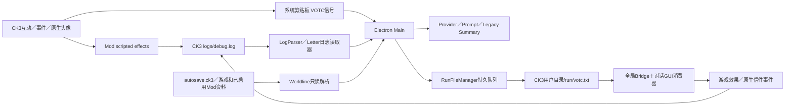

# V9.6 前置探索：统一交付、独立运行

> Historical exploration: unified Workshop distribution and Bootstrap proposals are superseded by the user-authorized independent Mod/Runtime design. See [V9.6 implementation](V9_6_IMPLEMENTATION.md), [verification](V9_6_VERIFICATION.md) and [pairing](V9_6_RELEASE_PAIRING.md).

日期：2026-10-24。Runtime 基线 `060e336ce64d844dc32a122038b38bc02fb3a134`，Core/App/UI 仍为9.5.1。本轮是只读源码与分发可行性探索，未实施9.6、未变更版本、协议或安装内容。

用户最新目标优先：订阅 Workshop 后取得必要程序，不再单独去 GitHub 下载 VOTC；包内 Mod 和 Runtime 保持职责与版本边界。原探索文档／路线图将统一分发排在9.7，本报告将它作为9.6目标的前置研究，不据此提前实现 Bootstrap 或发布。

输入设计文档：`VOCT_V9.6_前置探索文档.md`，SHA-256 `e105487011ed5d53de41e3eb4229d7373240e56264ededae4d3a00ce515d2008`。其中“尚未访问本机Workshop”的说明属于原文当时的证据边界，本轮已补充实际文件取证。

## 已确认的结论

1. 本机自身 Mod 位于 `D:\SteamLibrary\steamapps\workshop\content\1158310\3346777360`。共97文件、12,995,956字节；descriptor 声明2.0.5、CK3 1.20.*。这是**带本地修改的安装快照**，不能认定为干净的Steam最新发布。
2. 仓库七个Bridge补丁与安装文件原始字节全部相同；完整Mod尚未成为Runtime仓库的构建输入。
3. 找到README指向的公开上游 `Voices-of-the-Court/votc_mod`。固定提交 `0cf4845a69f9e8633333ca04e558afe8216490f2` 的descriptor仍为2.0.4；不能直接拿它替换本机2.0.5。比较结果与许可证边界见[源清单](V9_6_SOURCE_INVENTORY.md)。
4. 当前主要通信为debug.log、剪贴板、`run/votc.txt`。Mod负责采集资料与执行游戏效果；Runtime解析、生成回复及效果脚本，并管理队列、回读和恢复。没有HTTP/socket Bridge，也未找到配对的版本／能力握手。
5. 不能只检查Mod里的marker：RUN_ACK、Action回读、Letter回执由**Runtime生成CK3脚本，再由游戏输出**。反过来，Worldline还直接读取存档、加载描述文件和游戏／Mod的历史与本地化资料。
6. `MEMORY_ENGINE_VERSION="3.0"` 是记忆兼容标记，不是已存在的Bridge协议版本；Mod 2.0.5、Official Action 2.0.3、App 9.5.1也不能互相当作协议版本。
7. 技术上可优先设计“一个交付入口、两份不可变工件、独立版本、兼容合同”。任意破坏性更新都互不影响无法保证；合同内兼容更新可以独立发布，破坏性更新需要保留旧适配或协调升级。

## 现有数据流

游戏头像／场景由Mod原生GUI渲染，Electron窗口显示生成对话；本轮未发现头像位图经过上述日志通道传输。

## 交付导航

- [源码、完整文件哈希与来源差异](V9_6_SOURCE_INVENTORY.md)
- [通信、状态及跨端符号矩阵](V9_6_BRIDGE_PROTOCOL_MATRIX.md)
- [版本与能力兼容候选](V9_6_COMPATIBILITY_MATRIX.md)
- [源码纳管及统一分发决策记录](V9_6_ARCHITECTURE_DECISION.md)
- [无副作用原型与真实CK3验收计划](V9_6_CK3_LIVE_TEST_PLAN.md)

本轮读取当前源码、安装Mod和公开上游；未读取真实存档、debug.log、APPDATA设置／凭据，未启动游戏／App、调用Provider、写入RunFile、导入完整Mod或上传Workshop。只生成审计资料并做哈希／引用一致性检查，不跑完整发布门禁。

审计自检PASS：97文件重新校验、七补丁原始字节一致、270处marker源行与972行词法符号引用可定位、61类IN均有parser分支、六份文档的11个内部引用有效。`src/`、`resources/`、构建映射、包版本与现有补丁均零改动；独立只读复核已完成。该结果是文件／引用检查，不是Runtime合同测试或CK3实机PASS。

## 仍需在正式施工前解决

当前安装快照和上游参考均已定位，但**本fork今后唯一Mod权威源、差异归属、Workshop发布身份仍未最终确认**。平台是否允许该CK3 Workshop项携带并运行Windows Runtime、首启入口、离线安装与更新锁行为，也尚未实测。它们是下一阶段的明确前置条件；本轮不把探索报告当成源码纳管或实机验收完成。
