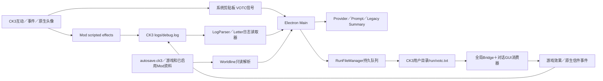

# V9.6 版本册

原文按来源合并，保留设计、实施、修复、失败与待验结论；历史文字中的“当前”只属于其原版本。源码快照：`9449b0a4bc6b0616452b31fb8c79eafeae829bf5`。旧页仅保留链接兼容索引。

- [V9_6_1_IMPLEMENTATION.md](#source-596e0a06c9de)
- [V9_6_1_WORLD_MEMORY_RESTART_FIX.md](#source-bb362f73c282)
- [V9_6_ARCHITECTURE_DECISION.md](#source-bd0cc0804a15)
- [V9_6_BRIDGE_PROTOCOL_MATRIX.md](#source-72692e9d7ae7)
- [V9_6_CK3_LIVE_TEST_PLAN.md](#source-34a7ce4b1dda)
- [V9_6_COMPATIBILITY_MATRIX.md](#source-7057fe08b8b3)
- [V9_6_DESIGN.md](#source-13b6b164baaf)
- [V9_6_FAMILY_AGE_FIX.md](#source-cf26133a47a0)
- [V9_6_FIRST_MEETING_IDENTITY_FIX.md](#source-1d808a21ac52)
- [V9_6_IMPLEMENTATION.md](#source-8c1174818c66)
- [V9_6_PRE_EXPLORATION.md](#source-15908472dd75)
- [V9_6_RELEASE_PAIRING.md](#source-b8d0f868fb35)
- [V9_6_SOURCE_INVENTORY.md](#source-27f26871c8fd)
- [V9_6_VERIFICATION.md](#source-289d6ac6da3e)
- [V9_6_WORLD_MEMORY_RECALL_FIX.md](#source-8adc32076b64)

<!-- chapter:source-596e0a06c9de:start -->
<a id="source-596e0a06c9de"></a>
## 来源：docs/current/v9/V9_6_1_IMPLEMENTATION.md

原文规范化 SHA-256：`dab81aacc98f242090b975f5ff953de0c7dd60c08c2378fcf3eedbae781b5c69`。

<a id="source-596e0a06c9de--v961-关系识别与五代亲属身份修复"></a>
# V9.6.1 关系识别与五代亲属身份修复

日期：2026-10-27。基线为 `24d813d`；Core／App／UI 为 9.6.1 候选。Workshop 仍是独立维护的 2.0.5，Bridge 1、日志协议 3.0、Legacy Summary 存储 2.5 和 Official Action 2.0.3 保持。没有上传 Steam，没有新增付费请求。

自动化收口：准确提交 `f783fd070ba5dc00143e94c8196da34898e3c618` 的 [Windows CI 40495012370](https://github.com/wsdsb-111/VOCT-NEW/actions/runs/40495012370) **PASS**：518 组完整发布回归、353 项源码／构建／部署一致性，以及完整 Windows 分发 EXE 冷启动、同配置重启、Preload／IPC、ffmpeg／PCM 媒体解码和正常退出。本机安装与远端 Runtime payload 完全一致。随后仅本报告记账，不改变已验证代码或 payload；真实 CK3／Provider 回复、性能、命中率和 Soak 仍单独待实机验收。

<a id="source-596e0a06c9de--本轮合同"></a>
## 本轮合同

依据用户提供、于 10 月 26 日读取的 `V9.6.1_RELATION_RECOGNITION_AND_IDENTITY_FIX.md` 实施；原 Downloads 文件现已不可用，不将本报告冒充设计原文。用户补充的五代亲属要求优先于设计文档原本较窄的资料白名单。

每位回应者分别判断关系：祖父母辈、父母辈、本人及同辈、子女辈、孙辈，包括对应旁系和当前合法配偶，涵盖父母再婚配偶、兄弟姐妹及子女的配偶。已验证的同一五层关系双向互知；旁系按有来源的家谱路径计算，不按姓名、同姓或模型猜测。婚姻只允许位于血缘路径的一个端点，不沿多次姻亲递归扩散。超过范围、来源陈旧或冲突、图范围截断时不新增资料授权。

范围内的当前姓名、年龄、头衔、特质和关系可直接展示。当前公开合法亲子证据不因人物带有私生子特质而失效；未经公开验证的生物学关系仍不授权。手动隐藏优先，秘密、他人的知情秘密、旧对话和历史记忆权限不随亲属白名单扩大。

<a id="source-596e0a06c9de--实现"></a>
## 实现

- `family-visibility.js` 在有界关系图上按五层路径及其反向构造资料范围。发现阶段同时收录 canonical 人物与嵌套亲属记录，允许仅有单向记录时反向发现；提名本身不授权。按最短深度分层入队，避免先发现的深路径遮住后续近路；节点上限仍为 4096。
- 单个人物披露与两人关系检查只以回应者／目标为种子，不枚举人物目录；完整 Prompt 投影才构造反向发现索引和完整别名目录。原有披露 UI 的“不扫描全部人物”边界继续生效。
- `trait-profile-selector.js` 使用完整原始人物目录收集身份别名，与有界关系图分开。场景、描述、地点、领主、配偶、皇帝及消息署名继续使用投影身份；不会修改真实发言或原始 GameData。姓名、年龄／终年、头衔和特质的手动隐藏分别复核，披露存储也保留已有手动隐藏。
- `prompt-builder.js` 将原始关系 authority 留在后台家庭事实构造器中；模板和描述脚本仍收到投影。订婚、前配偶和继亲查询只输出验证后的最小结构化关系文本，关系姓名授权不解锁非亲属的年龄、特质或头衔。诊断不打印查询正文或目标姓名。
- 日志解析器绑定订婚、当前配偶、前配偶的 owner／target ID、Campaign、日期／游戏日快照和冲突状态。关系图生成独立 `BETROTHED_TO`，支持子女→订婚对象的链式查询，拒绝错 owner、冲突重复、多对象和未知性别强行选人。现任／前任婚姻冲突仍无法确认为某一关系。
- `ck3-mod/common/scripted_effects/log_character_v2_effect.txt` 增补当前配偶及前配偶导出，并为订婚对象提供游戏性别。已核对安装的 CK3 脚本存在 `every_former_spouse`；该源只证明观察快照下的前配偶身份，不提供结婚／离婚起止日期，也不推导历史继亲。
- 缓存键包含婚约、婚姻和来源信息；当前对象可在同一天原地变化，因此不信任调用方自报的修订号作为不变性证明。局部图复核有界邻域；完整身份目录和反向发现索引仍需读取人物目录，不宣称整次投影为常数开销。
- 存档配偶保持独立来源：解析器依据原始 `family_data.spouse` 建立绑定 playthrough／日期／完整存档指纹的 `CK3_SAVE_LEGAL_SPOUSE` 证据，关系检查器只在原字段、双方 ID 和当前快照均吻合时采用；修改原配偶而保留旧证据不会授权。此路径不会成为实时 Campaign 的资料白名单，避免实时来源收紧误伤已有存档关系查询。

Prompt block ID 与缓存锚点没有变更。V9.6 世界记忆补丁保持：普通 Canon 进入动态补充块，开场固定内容、来源／Forget／分支／预算检查不变。

<a id="source-596e0a06c9de--验证与安装"></a>
## 验证与安装

新增六组发布测试：关系识别、五代资料、身份目录规模、缓存正确性／合成规模、默认 Prompt 主链及 Terra 独立边界。已登记 `scripts/test-manifest.js`，完整门禁组数以该清单实际输出为准。

本机使用单进程、384MB 串行验证。已通过五代资料独立 QA、Terra 真实解析器与披露存储 QA、婚约／前配偶识别、无预置 NAME 的默认 Prompt、陌生人身份、兄妹年龄、亲属来源、继亲来源、世界记忆及测试清单专项。Terra QA 覆盖亲属／配偶是否在 canonical 目录的组合、反向关系、过期／错 owner／错 Campaign／冲突证明、隐藏终年和最短路径竞争。此前合成目录检查不作为真实大存档性能签署；用户已要求耗时及缓存命中率由其实机测试，后续不再加跑本机负载。

旧测试中“已验证公开合法亲子仍仅因私生子特质而拒绝资料”的断言按用户本轮规则更新；未公开关系的反例保留。婚约回归将未知性别子女的歧义负例与唯一已知子女的正例分开，未降低解析门禁。

Runtime 的 353 项资源已构建、部署到原安装目录并逐项核对一致，最终 payload 为 `f7069c5824d0188235d2d8fd396ee86c23b7283aa688c41460d6c2b55016721f`，部署备份保留在 `.build/runtime-deploy-state`。依赖核验为 5981 文件／264 包；发布清单为 518 组。完整发布门禁交隔离 Windows CI，按准确提交补记，不能以此前 V9.6 的 CI 结果替代。

本机原目录隔离配置 EXE 检查已通过前端／Preload、版本 9.6.1 IPC 与合成 PCM 媒体解码，随后 `app.quit()` 退出为 `3221225477`（`0xC0000005`），因此整项记为 **FAIL**。没有未处理 JavaScript 异常先于退出；当前证据不足以认定原因。匿名检查结果在 `.build/v961-installed-smoke-evidence.json`，没有使用真实用户配置。本机捆绑 Node 22 本轮还出现进程初始化失败 `0xC0000142`，专项改用本机 Node 24.13.0；Node 22 的完整兼容性由远端单列核验。

随后按远端 CI 的普通启动参数（不额外启用 `--enable-logging=stderr`），在同一原目录与隔离配置复测 **PASS**：9.6.1 IPC、Renderer／Preload、中文语言包、ffmpeg 加载／合成 PCM 解码、`app.quit()` 退出码 0；证据在 `.build/v961-installed-smoke-normal-evidence.json`。首次失败保留于 `.build/v961-installed-smoke-logging-failure.json`，一次复测不证明日志参数是唯一原因，也不替代真实 CK3／桌面输入验收。

本机 VOTC Workshop 导出文件已同步，旧文件备份在 `.build/v961-local-mod-backup`；新文件 SHA-256 为 `235fd463ff099cf63577a73cb2136caaa41625b2a9482abc431d6edc65bc35d4`，独立 Mod 的 97 文件 payload 为 `866f32ba82bb6d9c7d0dec4aee8568450efbfe60e7f4e151c1c13d7c0c4db8eb`。Steam 未上传。获取新增字段须重启 CK3 并重新发起对话。

真实 CK3 对话、Provider 新回复、缓存命中率及 Soak 尚待用户实机验收。自动化、程序启动和完整发布门禁分别记录，不宣称 Full Freeze。

首个代码提交 `f1a6423`／[Windows CI 40483188318](https://github.com/wsdsb-111/VOCT-NEW/actions/runs/40483188318) 的完整回归为 **FAILED**：Bridge 合同测试仍固定旧 Mod payload 指纹，未跟随本轮有审查的导出更新。已将固定断言更新为本轮 97 文件的完整指纹，未取消哈希检查。该次 CI 的独立 Mod、构建部署及完整 EXE 冷启动／同配置重启／媒体解码和正常退出已通过；本机退出失败仍独立保留。后续准确提交的全量结果另记。

`9b78bab`／[CI 40483705239](https://github.com/wsdsb-111/VOCT-NEW/actions/runs/40483705239) 的完整回归也为 **FAILED**：Bridge UI 测试的两个正则仍固定 9.6.0，已改为核对当前 App 包版本；没有降低版本一致性断言。该次完整 EXE 检查仍通过。前两次 CI 的 Runtime payload 均为 `7ff88067693e98abbdcf49f23d0a702357b423e94091207ec092081045df0f59`，后续存档来源修正采用上述新 payload。

`994a0d6`／[CI 40486506726](https://github.com/wsdsb-111/VOCT-NEW/actions/runs/40486506726) 回归为 **FAILED**：原有披露存储的禁止全目录扫描用例发现两人判断错误地构造了完整反向索引。已将两人路径改为仅按双方种子有界发现，原测试未改且专项通过；完整 Prompt 仍保持全目录身份脱敏。该次完整 EXE 检查通过。最终 CI 结果另记。

`cd85573`／[CI 40487515346](https://github.com/wsdsb-111/VOCT-NEW/actions/runs/40487515346) 回归为 **FAILED**：两人查询先将无 canonical 记录的场外 ID 登记为空节点，阻止后续真实内嵌亲属记录入队，使合法亲属的未知年龄诊断丢失。已跳过不存在的纯 ID 提名，并增加真实日志解析后的场外亲属两人查询反例；原年龄测试保持且专项通过。该次完整 EXE 检查通过，payload 为 `53cb91a6ab3ab2877e89f2bc7c97c22cdb1ee44697690c26f9eef9dc47e02c70`。修正后的原目录隔离启动、IPC、媒体解码和退出码 0 已再次通过。

`3e46921`／[CI 40488741390](https://github.com/wsdsb-111/VOCT-NEW/actions/runs/40488741390) 回归为 **FAILED**：旧夫妻正例只有裸配偶字段，并仍断言配偶不互知性格，与本轮来源及五代合同不符。已为旧婚姻／手足正例补齐解析器使用的当前来源字段，保留原称谓、性别、死亡和冲突断言；夫妻的过期／错 Campaign／秘密来源负例也使用完整证据后逐项破坏。公开合法亲子不再因私生子特质被排除；手动隐藏优先于自动观察／亲属来源。这些规则已按用户新合同更新测试。该次完整 EXE 检查通过，payload 为 `28a1394262ed8ef14c28e0084fff491ea1f08f625cb0eb68fd782932d7dea6f0`。

随后定向串行补查发现并修正生产边界：亲子重复证据 ID 的字符串／数字比较错误会漏掉冲突，现保留外层及嵌套的 STEP 冲突并校验所有候选；公开 otherParent 不可借归一化丢掉 STEP 标记。家庭事实在后台沿用 GameData 合并的当前反向亲子来源，仍不把原始 authority 暴露给模板，并保留普通对象人物目录兼容及直接查询的生死诊断。相关 60 组定向检查初次有六项失败，修正来源样例与上述实现后，全部失败组已单独复测通过；相关未知年龄、陌生人、默认 Prompt、Terra QA 和本机隔离 EXE 也通过。未重复执行性能或完整本机发布负载，最终全量 CI 另记。

`6636794`／[CI 40491358079](https://github.com/wsdsb-111/VOCT-NEW/actions/runs/40491358079) 回归为 **FAILED**：旧 AGE-01 配偶年龄样例仍缺当前婚姻来源。已仅补齐 canonical／场外配偶正例的来源与不同 targetBound，保留全部年龄、来源冲突和披露断言。A01–A14 专项及另外 20 组年龄／时间专项本机串行通过。该次完整 EXE 检查通过；Runtime payload 与当前安装一致，后续仅测试与报告变更不改变该 payload。

`07bbfe2`／[CI 40491998176](https://github.com/wsdsb-111/VOCT-NEW/actions/runs/40491998176) 回归为 **FAILED**：旧特质投影用例要求有当前合法亲子证据的场外子女仍隐藏资料，已按本轮五代规则更新，并新增快照过期后整条场外亲属被移除的反例；秘密及陌生人断言保持。该组与发布清单中的 visible-traits 专项均通过，完整 EXE 检查也通过。额外误运行了清单中已归档的 `test-v8.15.2-provider-visible-traits.js`，其依赖已退役 `engine.memory4.buildOwnerSnapshot` 而失败；未把它计入发布通过数，未为旧测试恢复 Memory4，未发起外部请求。

`680f087`／[CI 40493089651](https://github.com/wsdsb-111/VOCT-NEW/actions/runs/40493089651) 回归为 **FAILED**：根目录主题预览页仍显示 9.6.0，与已交付包版本不符。已将预览标题及页脚同步 9.6.1，版本一致性测试不变；该次完整 EXE 检查通过。

`69315ee`／[CI 40493953826](https://github.com/wsdsb-111/VOCT-NEW/actions/runs/40493953826) 已运行到第 421 组，回归为 **FAILED**：多重亲属正例仍使用无来源婚姻及不完整 checkpoint，现保留 Legacy 多重关系检查，当前查询补来源，检查器改用真实 `parseGameState` 合成存档。另九组定向关系边界检查发现旧上限测试期待在上限之外合成第 3 个 partial 节点，已改为更严格的恰好 2 节点、无第 3 节点及 `scopeTruncated=true`，完整范围正例保持。两项专项已通过；该次完整 EXE 检查通过，Runtime payload 保持。

最终准确代码与测试提交 `f783fd0` 的 CI 已全部通过，Node 为 22.23.4；测试清单实际分类 646 文件，518 发布组、127 历史归档。完整分发复制为 6406 文件／340998550 字节，tree SHA-256 为 `138ee871136f942fb9d95fa0044535ae7b11f0509fb2e1d1db69b3d62b7ad958`；两次 EXE 启动均完成 9.6.1 版本 IPC、Renderer／Preload、语言包和媒体检查，并以 0 退出。Runtime payload 为 `f7069c5824d0188235d2d8fd396ee86c23b7283aa688c41460d6c2b55016721f`，与本机部署回执一致。匿名证据上传于该 run 的 `v94-packaged-smoke-f783fd070ba5dc00143e94c8196da34898e3c618` artifact。人工输入焦点／草稿持久化和透明区域穿透未运行；不能以该 CI 替代用户真实游戏对话与耗时／缓存测试。Terra 子代理本轮纠正后仅以 high 完成独立边界样例和最终静态复核，测试由主代理串行运行。

<!-- chapter:source-596e0a06c9de:end -->

<!-- chapter:source-bb362f73c282:start -->
<a id="source-bb362f73c282"></a>
## 来源：docs/current/v9/V9_6_1_WORLD_MEMORY_RESTART_FIX.md

原文规范化 SHA-256：`25d64af6720c1270e993ac0b64b6edad11d116ad8674605753e047b834494f26`。

<a id="source-bb362f73c282--v961-世界记忆重启与召回预算修复"></a>
# V9.6.1 世界记忆重启与召回预算修复

日期：2026-11-01。本轮为 V9.6.1 修复补丁，Core／App／UI 版本保持；Workshop 2.0.5 未修改或上传。普通世界记忆动态召回上限按用户要求调整为 4096 Token。

准确代码提交 `7d05c3d11e8296ca1de93a7faf2a371c99288604` 的 [Windows CI 41263860222](https://github.com/wsdsb-111/VOCT-NEW/actions/runs/41263860222) **PASS**：519 组完整回归、353 项构建部署核验及完整分发 EXE 冷启动／同配置重启／IPC／媒体解码／正常退出，Runtime 指纹与本机一致。后续仅本报告记账，未更改已验证代码。

<a id="source-bb362f73c282--确认的故障"></a>
## 确认的故障

1. 编辑器测试允许 640 Token，正式当前轮召回被 `WorldlineService` 再限制为 512。用户现存的一条完整记忆连同头部需约 554 Token：原测试可选中、正式路径跳过。被跳过时没有预算原因；相关 Canon 数字诊断也被 analytics 的投影丢弃。
2. 记忆文件及修订链仍完整，存在 1 条 ACTIVE 记录；重启后读取的同路径存档与已登记快照日期相同、内容指纹不同。原分支检查正确阻止自动延续，但列表将未绑定状态返回为空，前端错误展示成“没有长期记忆”，且同日内容变化没有“确认延续”入口。

没有发现这条记忆被删除或保存只留在内存的证据。排查只读原数据；没有把用户存档、日志、记忆正文或凭据提交到仓库。

<a id="source-bb362f73c282--修改"></a>
## 修改

- `supplemental-retriever.js` 提供统一的 `SUPPLEMENTAL_MAX_TOKENS=4096`。测试召回、当前轮服务和 Conversation 的实际当前查询路径共同使用它，仍取请求剩余上下文允许的较小值，并扣除本轮覆盖补丁。完整来源放不下时不截断正文，返回预算拦截数、所需和可用 Token；测试显示 `BUDGET_EXCEEDED`。
- 保留世界线 CK3 数据的既有预算、开场固定规则的显式小预算及历史查询预算。普通 Canon 继续位于原动态覆盖块；Prompt block ID、静态冻结顺序与已冻结内容没有改变。权限、时间、当前事实冲突与发送前复核继续生效。
- 同日不同指纹仍是 `BRANCH_CONFLICT`，不自动延续。注册表只额外提供同 Campaign／同路径的原分支 ID，供编辑器读取只读预览；不把它登记为可召回 snapshot。NPC 召回和测试在待确认时被阻止，写入／删除保持原门禁。用户明确确认后通过既有 continuation API 更新绑定，原记忆及修订历史不复制或重写。
- 前端中英文显示“存档内容变化，需确认延续”、只读记忆和恢复入口。待确认不再冒充空档；测试／编辑／删除受限。未知或其他 Campaign 不推断绑定。
- 世界线诊断仅保留候选数、选中数、Token 与拦截计数，缺失值保持未知，不记录正文。原生 Provider 用量及其独立保留策略不变。

<a id="source-bb362f73c282--本机恢复及验证"></a>
## 本机恢复及验证

用户已明确确认这是原时间线继续游玩。程序退出后，原注册表与记忆文件先备份至忽略目录 `.build/world-memory-recovery-20261101-mXQJXr/`，随后仅确认分支延续。结果：1 条记忆恢复可见，原 state 文件 SHA-256 不变；重新构造服务仍读到 1 条；本地检索完整选中约 554 Token。恢复回执在该目录 `receipt.json`。这不是一次真实 NPC／Provider 请求。

新增并登记 `test-v9.6.1-world-memory-restart-budget.js`，先复现旧测试／正式路径不一致，再验证：

- 512～640 Token 区间、超过旧 900 Token 世界线预算但小于 4096 的完整记忆实际召回；超过 4096 和上下文仅余 128 Token 的明确拦截；不裁剪正文。
- 保存后全新服务读取、同日指纹变化的只读预览、未确认零召回、明确确认延续、再次重启、另一 Campaign 不继承，以及原记忆字节保持。
- 实际 Renderer 组件的中英文待确认显示、恢复按钮及禁止删除；analytics 存储预算原因且丢弃正文。

本机 384MB、单进程串行通过新回归、V9.6 Conversation→Canon→最终 Prompt 主链、Supplemental 存储／检索、生产 Canon、分支身份／前进／回档／历史恢复、测试 API、输入稳定性、世界记忆范围审计、双语覆盖及统计独立保留专项。新增测试清单完整性通过；当前发布清单 519 组，完整门禁交隔离 Windows CI。

已构建并部署 353 项 Runtime 资源，payload 为 `02c9cbf97be6ffb0a2d4d3e5313ad51132d877daf046f33a96e5309be3e7869a`，源码／构建／安装逐项一致。原目录隔离配置启动通过：9.6.1 IPC、Renderer／Preload、中文语言包、ffmpeg／合成 PCM 解码和 `app.quit()` 退出码 0；证据 `.build/world-memory-fix-installed-smoke.json`。真实用户配置未用于启动测试。

完整 CI 使用 Node 22.23.4，实际分类 647 个测试文件、519 发布组、127 历史归档；新增重启／预算回归也在隔离 Windows 上通过。两次完整 EXE 启动均读回 9.6.1 并以 0 退出。该提交 Runtime payload 为 `02c9cbf97be6ffb0a2d4d3e5313ad51132d877daf046f33a96e5309be3e7869a`，与本机部署一致。不能以此前 518 组的 V9.6.1 CI 替代本次记录。真实 CK3 新对话／模型回复及 Soak 未验收，无新增付费请求。

<!-- chapter:source-bb362f73c282:end -->

<!-- chapter:source-bd0cc0804a15:start -->
<a id="source-bd0cc0804a15"></a>
## 来源：docs/current/v9/V9_6_ARCHITECTURE_DECISION.md

原文规范化 SHA-256：`81f54db8c47cfc8cc6300d04e8f00563456e878996a78827c1dc1653b543f02b`。

<a id="source-bd0cc0804a15--v96-探索架构决策同仓可审计交付统一工件解耦"></a>
# V9.6 探索架构决策：同仓可审计，交付统一，工件解耦

> Historical exploration: unified Workshop distribution and Bootstrap proposals are superseded by the user-authorized independent Mod/Runtime design. See [V9.6 implementation](V9.6.md#source-8c1174818c66), [verification](V9.6.md#source-289d6ac6da3e) and [pairing](V9.6.md#source-b8d0f868fb35).

日期：2026-10-24。状态：**探索推荐，非迁移／发布批准**。用户将统一交付作为9.6目标；本轮不实现安装器、自动更新或Workshop发布。

<a id="source-bd0cc0804a15--决策与依据"></a>
## 决策与依据

建议正式施工优先采用同仓的`src/app/`与拟建`ck3-mod/`两套权威源、各自构建清单和版本，协议合同集中登记。发布阶段再组装一个Workshop交付包；两套运行域保持现有日志／文件边界。源码同仓不等于两个版本必须同时增加，也不等于将Electron运行在CK3脚本引擎中。

| 选择 | 判断 |
| --- | --- |
| A 同仓完整Mod源＋独立工件 | 推荐候选；可同次审查跨端Effect／事件／parser，CI取得同一基线，适合当前已有本fork热修的情况 |
| B 独立Mod仓库固定commit引用 | 保留备选；若明确由另一维护团队负责，固定commit与哈希同样可行，需要跨仓协调 |
| C Workshop安装目录＋局部补丁长期作源 | 只适合当前取证；Steam更新会覆盖安装目录，无法由干净checkout重建完整Mod，不作长期方案 |

A的前置条件：确认本fork未来权威源及维护职责；逐项评审当前快照相对固定上游的19项规范化文本差异和5项新增，另做语义及归属核对；保留许可及改动说明。不能宣称本轮已纳管完整Mod，不能直接用上游2.0.4覆盖现有2.0.5。

<a id="source-bd0cc0804a15--一次下载与独立更新如何同时实现"></a>
## 一次下载与独立更新如何同时实现

候选包可分为Mod payload、带版本的Windows Runtime payload及小型启动入口／清单。玩家订阅获得必要字节，首次运行随包入口；开发者仍可在GitHub维护源码，但玩家正常安装不依赖手动访问GitHub。

优先研究：从Workshop只读payload向**独立、可写、按版本保存的Runtime目录**进行验证与激活，再启动现有VOTC进程。不要让运行中的EXE／DLL直接依赖Steam可覆盖的安装路径。个人设置、API凭据、Legacy、信件及RunFile队列继续留在现有userData；升级或回滚不删除、不盲目迁移这些状态。

Runtime payload必须来自干净的受校验发行构建，不把当前开发目录整体压入Workshop；排除`.git`、`.build`、测试profile、日志、真实存档和个人数据。游戏脚本与Electron资源分别做输入／产物清单，合并发行时只引用可分发工件。

必须分别解决：订阅下载、首次启动、已运行进程更新、游戏中Mod更新后激活、回滚。Steam文档说明Workshop安装／更新由Steam客户端处理，且新订阅可能在游戏启动后仍在后台下载；[官方安装规则](https://partner.steamgames.com/doc/features/workshop/implementation#Item_Installation)并未授予当前CK3 Mod自动启动任意外部程序的能力。**文件到达不等于程序启动**，不承诺“订阅后自动运行”。

当前本fork自动更新已关闭，且已有单实例锁。新入口首先处理已有进程与安全退出／延迟激活，不能绕过部署保护、自动重启正在生成的对话，或启动第二个Runtime。新版本与旧版本不能同时争用同一`debug.log`／剪贴板／RunFile队列。

<a id="source-bd0cc0804a15--更新矩阵与回滚原则"></a>
## 更新矩阵与回滚原则

| 更新 | 应保持的隔离 |
| --- | --- |
| 仅App的UI、Provider或内部算法 | Mod哈希和wire contract不变；不覆盖游戏源或存档变量 |
| 仅Mod场景／原生GUI | App保持不动；涉及导出、脚本函数、事件或全局变量时仍需合同测试 |
| 修改导出／ACK／Receipt语义 | 协议major或相应contract升级，保留支持旧格式的适配范围；不靠相同版号假定兼容 |
| Steam更新而游戏／App仍运行 | staging与当前active分开；先保留旧进程，下一安全启动校验本场Mod声明及工件组合 |
| App回滚 | 先检查持久数据可读范围；队列写出／ACK证据保留，未知Effect不重放。旧二进制不能在不理解新状态文件时直接写入 |

“互不受更新干扰”限定为已声明支持的合同内组合；任意破坏性变更、CK3引擎升级和第三方覆盖都无法无限保证。独立版本＋明确支持范围＋跨版本fixtures，才是可验证的目标。

<a id="source-bd0cc0804a15--发布前仍需证明的事实"></a>
## 发布前仍需证明的事实

- Workshop项3346777360的实际发布维护权限，或本fork采用的新item；descriptor的remote_file_id不证明账户权限。
- CK3／Paradox对于随Mod分发Windows可执行payload的具体规则、扫描与首启体验。只查阅通用[Steam Workshop实现文档](https://partner.steamgames.com/doc/features/workshop/implementation)，未获得CK3特定发布批准，不推断“必定允许”或“必定禁止”。
- Mod README／LICENSE声明CC BY-SA 4.0，Runtime包声明GPL-3.0-only；各组件保留独立许可、署名与改动记录，另审Electron／native依赖及素材。参见[上游](https://github.com/Voices-of-the-Court/votc_mod/tree/0cf4845a69f9e8633333ca04e558afe8216490f2)、[CC条款](https://creativecommons.org/licenses/by-sa/4.0/)。不将本报告当成重许可或发布批准。
- Workshop体积、杀毒／SmartScreen、安装路径权限、Windows文件锁、离线首启和回滚空间。当前Mod约13MB，完整Runtime分发远大于Mod；本轮不以未测量值设平台结论。
- Mod源构建与Runtime构建应各自有manifest，再由release manifest引用两份哈希；不要直接把全部Mod文件塞入目前仅接受Runtime源的`build/runtime-inputs.json`。

若平台或首启验证不通过，应如实记录统一Workshop交付尚不可用。只在Workshop放一个要求玩家去GitHub找程序的链接，不能算达到用户的一次下载目标。

<!-- chapter:source-bd0cc0804a15:end -->

<!-- chapter:source-72692e9d7ae7:start -->
<a id="source-72692e9d7ae7"></a>
## 来源：docs/current/v9/V9_6_BRIDGE_PROTOCOL_MATRIX.md

原文规范化 SHA-256：`1265e6f850a78d9b3ec01a4ca74116ba7ab207620aae0fbfb0deb5c5c0b9ad4d`。

<a id="source-72692e9d7ae7--v96-当前通信与依赖矩阵"></a>
# V9.6 当前通信与依赖矩阵

日期：2026-10-24，Runtime 060e336与[本机Mod指纹](V9.6.md#source-27f26871c8fd)。以下为当前源码确认；频率、事件顺序与效果仍待引擎验证。

路径约定：`R:`是仓库`src/app/main/`；`A:`是`src/app/default_userdata/actions/standard/`；`M:`是Mod根目录。完整定位见[VOTC字面标记及符号引用索引](../../current/v9/v96-marker-source-index.json)：270处`VOTC:`源码引用、61类IN数据及972行Mod符号引用。索引包括注释、解析正则和动态脚本模板，**不是270个实际协议，也不是可达性证明**。

<a id="source-72692e9d7ae7--通道与格式"></a>
## 通道与格式

| 通道／格式 | Producer → Consumer | 触发、会话与恢复合同 |
| --- | --- | --- |
| debug.log：`VOTC:IN/;/<type>/;/<位置字段>` | M `log_gamedata_v3_effect.txt`、`log_gamedata_v3s_effect.txt`、`log_gamedata_v3l_effect.txt`、`log_character_v2_effect.txt` → R `game-data/log-parser.js:37,142` | 互动调用8999／9000／9001后导出；解析整个日志，以最后init构造GameData。不是后台连续全量同步；依赖行顺序与init先行 |
| debug.log：`VOTC:CAMPAIGN/votc8c-<12digits>` | M `votc_campaign_identity_effect.txt`及三种导出 → `log-parser.js:137` | 存档内12个campaign数字flag；不等于一次载入session或存档分支 |
| 剪贴板短信号：`VOTC:IN` | 8999／9000／9001事件描述＋`event_window_widget_talk_v2.gui:6` → R `main.js:579–645,1131` | 100ms监听，保留／恢复原剪贴板；新会话随后读取日志。无request ID／可靠消息队列，不能当ACK |
| debug.log：`VOTC:LOAD_SESSION/;/votc-load-<epoch>` | M `common/on_action/votc_load_boundary.txt:5–24` → R `letters/letter-manager.js:330`、date scanner及Worldline probe | 新游戏／读档钩子递增存档内epoch。需同时绑定日志身份和边界偏移；同一旧存档重载可能重复字符串，不能当全局唯一ID |
| debug.log：`VOTC:DATE/;/<totalDays>/;/<shortDate>` | M `votc_runtime_clock.txt:1`及after-lobby钩子 → R `letter-manager.js:367`、`letter-date-session-scanner.js:283` | 全局GUI声明约2秒循环；数字totalDays是信件时间依据，shortDate为可读文本。轮转／截断／读档按现有身份与边界重建，不沿用旧日期 |
| 文件：`<CK3用户目录>/run/votc.txt` | R `actions/run-file-manager.js:249–285` → M全局Bridge及`talk_window_v2.gui:59–84` | UTF-8 BOM、临时文件原子rename；全局约2秒、对话约0.4秒消费。多入口重复轮询依赖同command ID游戏变量去重 |
| debug.log：`VOTC:RUN_ACK/<KIND>/<commandId>` | **R生成脚本，CK3执行输出** → `letter-manager.js:345`、`actions/run-command-recovery.js` | 回读匹配队列头ID／kind，持久化后推进。已写无ACK进入STALLED／恢复核对，未知效果不自动重放；不是Mod固定Hello |
| 剪贴板：`VOTC:EFFECT_ACCEPTED` | RunFile末尾触发M `mcc_event_v2.9003`＋talk widget → R `main.js:1142` | 仅界面提示；Main明确仍等待command-specific debug ACK，不能替代状态确认 |
| debug.log：`ACTION_BEGIN/ACTION_EFFECT/<id>`、`ACTION_SOURCE/;/<id>`、`ACTION_TARGET/;/<id>`、`ACTION_BINDING_FAILED`、`ACTION_INSUFFICIENT_GOLD` | R `run-file-manager.js:251`、`actions/action-effect-writer.js:53–59`生成 → `action-command-readback.js:7–42` | 同命令BEGIN—ACK内采集，8MiB尾部上限；交错／重复观察拒绝确认。金币／意见前后值经Mod `log_income`或动态IN行输出 |
| debug.log：`TRIBUTARY_ESTABLISHED/REJECTED`、`TRIBUTARY_CONTRACT_CONFIRMED/<group>`、`...REJECTED/ROLLBACK_FAILED` | A `z_becomesTributaryOf.js:55–59`、`z_changesTributaryContract.js:82–126`生成 → R `action-command-readback.js:22–28` | CK3寄附与契约Effect特定结果；同命令关联，不是通用执行成功信号 |
| debug.log：`VOTC:LETTER/;/<body>/;/<letterId>/;/<sendDay>/;/<delay>`＋剪贴板`VOTC:LETTER` | M `message_event.360/361`、本地化描述＋message widget → R `log-parser.js:121`、`letter-manager.js:324,1275`、`main.js:1145` | 先导出人物再写信。日志／剪贴板可能都触发；同letterId相同载荷复用，冲突不覆盖；不等于到期送达 |
| debug.log：`VOTC:LETTER_RECEIPT/;/<letterId>/;/<receiptToken>/;/<campaign>/;/<playerId>/;/<recipientId>/;/<day>/;/<date>` | **R `letter-manager.js:1539–1564`生成**，CK3创建宝物后输出 → `letter-receipt-recovery.js`、`processLogLine/clearLettersFile` | 同时依赖receipt token、人物、campaign、日志身份与载入边界；摘要与清理另有门禁。不是“玩家已阅读”的证据 |
| 剪贴板：`VOTC:LETTER_ACCEPTED` | **R生成Effect触发M `message_event.362`**，widget复制描述 → R `main.js:1153` | Main进入receipt处理／清理；正式receipt和summary门禁仍在。只搜Mod内部会误判362无调用方 |
| debug.log：`LETTER_TRANSPORT/A或B/<id>`、`LETTER_DIAG/A3/PRE或POST或SCOPE_OK/<id>`、`LETTER_DIAG/B或C或D/<id>` | R `letter-manager.js:2100`生成隔离诊断脚本 → 同文件361–365行 | 诊断ID关联，不是版本握手；本轮未运行诊断或写真实载体 |
| `DATE_PRODUCER/REARMED或BLOCKED/<id>`、`TEST_CHAR`、`TEST_DATE`、`IDLE_NOOP` | R旧兼容／诊断／安全空载体模板或解析保留，见字面索引 | 不据此声明当前Mod能力；无业务效果成功含义，不能用于Hello升级判断 |
| `CLOSE`、`BACKGROUND`、本地化中的短`DATE` | M保留描述／旧GUI路径 → Main剪贴板switch没有这三种case | CLOSE窗口无复制动作；BACKGROUND缺少已确认触发链。列为legacy／未闭合路径，不把本地化存在当活跃通道 |

<a id="source-72692e9d7ae7--in字段及数据边界"></a>
## IN字段及数据边界

`/;/`是位置分隔符，没有统一JSON envelope、能力header、完整frame长度或frame checksum。UTF-8／Unicode文本依赖CK3日志与Node读取；多行memory／letter由parser拼接，`#ENDMULTILINE`结束资源／关系明细。用户正文、人名、官方memory会随CK3语言变化，不能当机器ID；自由文本含分隔符是应加入fixture的边界。

- init位置字段：playerID、playerName、aiID、aiName、date、带固定前缀的scene、location、locationController、totalDays；消费点`game-data/game-data.js:33–34`。固定`substring(11)`也属于隐式合同。
- character为固定位置属性列，包含ID／姓名／称谓／当前年龄、技能、政体与宫廷字段等；消费点`game-data/character.js:18–25`。后续字段不能随意插列。
- 61类均找到parser case，详见JSON `inCategories`；资源类、memory、trait、秘密、关系、父母、子女、兄弟姐妹与persona等是同一日志协议的子类型，不是61个独立文件。
- Trait允许旧无key与新有key两种行，`log-parser.js:935–949`按长度决定偏移。今后直接追加字段可能误触旧长度启发式，不能宣称“任意尾部扩展兼容”。
- 官方追忆：Mod导出`memory` → `Character.memories` → `memory-system/official-recollection-provider.js`；保持CK3原文，不从UI语言生成另一份事实。
- Presence为App对话状态及IPC join／leave，不是现有Mod的`presence_v2`日志能力。Mod选择列表与原生头像槽位也是不同合同：日志人数不等于0..5六个头像槽的容量。

<a id="source-72692e9d7ae7--文件事件与符号硬依赖"></a>
## 文件、事件与符号硬依赖

| 依赖 | 两端用途 |
| --- | --- |
| `mcc_characters_list_v2`及顺序 | Mod导出候选人物；R ActionEffectWriter按ID在游戏列表绑定source／target，玩家绑定root；列表清空／换场影响旧效果有效性 |
| `log_income = yes` | R动作模板调用M scripted effect回读金币；不能只保留GUI与ACK而删除该effect |
| `mcc_event_v2.9002/.9003` | App关闭／效果封装与原生窗口生命周期；9003生成剪贴板提示 |
| `message_second_scope_letter_*`、`votc_letter_*`、`votc_latest_letter`、`message_event.362`、`votc_huixin_title*` | 写信线程、收件人scope、回信宝物、显示事件、本地化标题；App动态Effect引用，属于跨端合同 |
| `votc_last_action_command`／`votc_last_run_command`与`flag:<commandId>` | R生成、游戏保存，避免重复消费；不能因升级清除未知命令证据 |
| `votc_campaign_digit_01..12`、`votc_load_epoch`、GUI变量`votc_native_bridge_active` | campaign、载入标记、GUI注册分别不同；最后一个未被Runtime配对读取，不是正式握手 |

`gui/scripted_widgets/votc_runtime_bridge.txt:1`确实注册全局GUI，非仅有注释；实际引擎是否实例化仍未测。`letters_runner.gui`已退役，Mod未找到`run letters.txt`消费器；当前R LetterEffectTransport默认及loadState都强制VOTC模式（14、29行），Main 942–944行注入RunFileManager。legacy letters.txt方法存在，不等于生产仍走该路线。

<a id="source-72692e9d7ae7--额外的只读依赖与路径"></a>
## 额外的只读依赖与路径

- CK3用户目录由用户设置提供：`config/settings-repository.js:201–214`；日志为`logs/debug.log`，RunFile为`run/votc.txt`。不是从Workshop目录推导。
- `modLocationPath`有存取及IPC，但静态搜索只找到设置读取／写入，没有用它验证当前加载Mod或版本。
- Worldline直接监控／解析`save games/autosave.ck3`或所选路径，读取CK3游戏根及`dlc_load.json`启用Mod描述、本地化与历史资料（`worldline-service.js:345`、`localization-resolver.js:73–117`）。完整在途路线未见由对话日志导出，不应凭位置字符串推断。
- 应用数据位于Electron `userData/votc_data`，包括队列、信件、Legacy、配置及分析；`config/paths.js:5`。与安装／Workshop目录分离，统一交付不能把个人数据写回Steam安装树。
- 当前fork自动更新关闭：`app/app-updater.js:3–9`。存在单实例锁及active-win焦点监控；统一后的启动器需要复用该行为，而非同时启动两个Runtime。

本轮没有读真实日志或存档。特别是LOAD文本重复风险，现有Letter scanner已经使用文件身份、offset、轮转与anchor信息；Worldline `readLiveProbe`只复合使用birthtime／ctime弱身份与绝对偏移，没有在此路径发现持续的截断世代跟踪。原地重写到同位置可能碰撞仍是静态风险推断，不是已证实故障；不能将未来Hello所需的完整世代绑定误写成现有Letters“只按字符串、已发生串档”。

<!-- chapter:source-72692e9d7ae7:end -->

<!-- chapter:source-34a7ce4b1dda:start -->
<a id="source-34a7ce4b1dda"></a>
## 来源：docs/current/v9/V9_6_CK3_LIVE_TEST_PLAN.md

原文规范化 SHA-256：`e856e1443e50f22bb01c99373e2c3681f0b9c11fa573b8a2846512402d3c99eb`。

<a id="source-34a7ce4b1dda--v96-无副作用原型与实机验收计划"></a>
# V9.6 无副作用原型与实机验收计划

> Historical exploration: unified Workshop distribution and Bootstrap proposals are superseded by the user-authorized independent Mod/Runtime design. See [V9.6 implementation](V9.6.md#source-8c1174818c66), [verification](V9.6.md#source-289d6ac6da3e) and [pairing](V9.6.md#source-b8d0f868fb35).

日期：2026-10-24。状态：**计划，全部新原型与实机项NOT_RUN**。本轮只做[源与协议探索](V9.6.md#source-15908472dd75)，没有调用真实Provider或游戏Effect。

<a id="source-34a7ce4b1dda--逐层验证"></a>
## 逐层验证

| 层 | 目标与验收证据 |
| --- | --- |
| T1源码清点 | 源manifest／descriptor／事件、effect、GUI和localization引用完整；来源哈希、许可与上游差异可重现 |
| T2解析fixtures | IN固定列、61类数据、旧新Trait、Unicode／多行／分隔符、未知类型、半行和乱序；不使用真实对话或凭据 |
| T3双端合同 | 从拟纳管Mod产生匿名导出样例，由实际Runtime parser解析；command ID、kind、Source／Target、Receipt字段一致 |
| T4隔离打包 | 完整EXE与临时CK3用户目录，读模拟日志、构造临时carrier；个人userData与真实RunFile不参与 |
| T5 CK3引擎 | 真正加载Mod、新档／读档、触发GUI、DATE、可控Action与Letter；记录版本、存档测试范围及效果回读 |
| T6更新／恢复 | App与游戏重启、日志轮转截断、载体半写、ACK延迟／丢失、更新文件锁、回滚；无未知效果重放 |

T1–T4不证明引擎一定加载全局widget或执行Effect。旧V9.5.1的505组CI只作为历史Runtime证据，不能标成V9.6通过。

<a id="source-34a7ce4b1dda--helloprobe先行原型"></a>
## Hello／Probe先行原型

先测试独立schema与纯解析，不接生产。覆盖合法／非法schema、受支持与不受支持major、旧Mod无Hello、缺可选／必需contract、重复Hello、延迟旧Hello、相同文本LOAD标记在不同offset、原地日志重写、App重启后日志证据不完整。不得把存在descriptor当成加载成功。

若进入游戏原型，Hello仅输出声明与边界；专用Probe只回显随机关联标识，不创建宝物、不写人物变量、不推进业务队列、不触发9003界面事件。必须先审查路径确实无副作用；当前通用RunFile封装会追加9003，因此不能直接复用普通Action／Letter probe。全部使用隔离CK3用户目录、测试存档和临时carrier，绝不覆盖或清空真实`votc.txt`。

<a id="source-34a7ce4b1dda--必须签署的真实场景"></a>
## 必须签署的真实场景

| 场景 | 核验 |
| --- | --- |
| 新档启动、关闭聊天窗口、暂停／推进时间 | 全局widget实际注册，非对话期DATE持续；暂停时日期不推进不等于断线 |
| 保存／读档／同一旧档连续读两次 | 新日志边界使旧Hello和DATE失效；重复token文本不串用状态 |
| 开场／换人物／退出 | 日志导出与剪贴板唤醒先后、实际人物ID、原生头像与Electron对话对应，候场／缺席不扩大知情 |
| 一次低风险可控Action | command ID、列表绑定、重复GUI消费、BEGIN—ACK、实际前后值；区分ACK与CONFIRMED |
| 信件发送／到期／接收 | sendDay+delay、唯一宝物、362显示、匹配receipt、唯一摘要；重启后不重复投递 |
| 禁用Mod／旧Mod／移除某能力／其他Mod覆盖 | 状态与禁用范围准确，不默认为兼容，不使用真实高风险效果作为探针 |
| Workshop仅更新Mod／仅更新Runtime／同时更新 | 正在运行进程不被覆盖；下一安全启动取得支持范围内组合，旧工件可回退 |
| 无独立多Mod兼容补丁、离线无GitHub | 自身Bridge可独立工作；订阅payload具备完整依赖和入口，不额外要求玩家下载Runtime |
| 125%／150% DPI、焦点／穿透、长时运行 | 新入口不改变既有桌面输入行为；Soak记录资源与恢复结果，不仅截图 |

每次记录：CK3版本、Mod工件哈希／声明、Runtime工件哈希／版本、加载组合、隔离用户目录、会话／命令关联证据、观察到的实际效果和失败项。公开报告仅放脱敏结论，不提交真实日志、存档、队列或密钥。

<a id="source-34a7ce4b1dda--前置探索完成度"></a>
## 前置探索完成度

已完成本机源树、SHA-256、七个补丁对照、固定上游差异、跨端producer／consumer和候选兼容／分发方案登记。**尚未完成**唯一权威源最终批准、发布账户／平台确认、正式schema定稿、Hello／Probe实现和实机验收；不能据此宣布V9.6发布或Full Freeze。

<!-- chapter:source-34a7ce4b1dda:end -->

<!-- chapter:source-7057fe08b8b3:start -->
<a id="source-7057fe08b8b3"></a>
## 来源：docs/current/v9/V9_6_COMPATIBILITY_MATRIX.md

原文规范化 SHA-256：`666aecc18834eee1adab0aac17f3239ec4de6eab081da1c0a1b3aab621e0f3dd`。

<a id="source-7057fe08b8b3--v96-版本能力与失效策略候选"></a>
# V9.6 版本、能力与失效策略候选

> Historical exploration: unified Workshop distribution and Bootstrap proposals are superseded by the user-authorized independent Mod/Runtime design. See [V9.6 implementation](V9.6.md#source-8c1174818c66), [verification](V9.6.md#source-289d6ac6da3e) and [pairing](V9.6.md#source-b8d0f868fb35).

日期：2026-10-24。**以下为待批准设计，未实现握手、未修改现有门禁。** 当前事实以[协议矩阵](V9.6.md#source-72692e9d7ae7)为准。

<a id="source-7057fe08b8b3--版本必须分开"></a>
## 版本必须分开

| 维度 | 当前证据 | 下一阶段用途 |
| --- | --- | --- |
| App/Core/UI | 9.5.1，Runtime060e336 | 产品发布，不要求与Mod字符串相同 |
| 本机Mod | descriptor2.0.5／CK3 1.20.* | 本地声明，不能证明游戏当前加载的字节 |
| 上游参考Mod | 固定0cf4845，descriptor2.0.4 | 来源追踪，不是本机快照的替代版本 |
| Official Action | official-votc-2.0.3 | 动作业务基线，非Bridge版本 |
| Memory／Legacy存储 | MEMORY_ENGINE_VERSION3.0；既有Legacy2.5兼容 | 记忆合同，非Bridge协议主版本 |
| Bridge wire/schema | 未找到正式声明或配对协商 | 新增独立major/minor与schema定义，数值TBD |

不采用“App版本等于Mod版本才可用”。改UI／Provider／Prompt内部逻辑可独立发App；改游戏场景／图形且保持合同可独立发Mod；更改IN列序、事件ID、scope变量或ACK含义属于合同变更，需要适配与交叉版本测试。

<a id="source-7057fe08b8b3--按功能划分必需能力"></a>
## 按功能划分必需能力

| 功能 | 当前实际依赖 | 候选策略 |
| --- | --- | --- |
| 基础对话 | 可完整解析的IN init／character、合法玩家／人物身份、唤醒入口 | 资料缺失阻止该次生成；不凭Hello声明补造人物事实 |
| Trait／亲属 | 有key或旧兼容Trait、年龄和公开家谱证据 | 缺失保持未知，沿既有权限规则；不能为继续聊天猜测特质、身份或亲属 |
| 多人Presence | Mod候选列表＋App在场状态与定向披露 | `presence_v2`目前只是路线图候选名，不宣称Mod已实现该wire能力 |
| Action写入 | RunFile consumer、Mod effect／scope符号、command ID去重、匹配ACK | 证据不够只阻断相关副作用；ACK仍不等于效果CONFIRMED，旧未知命令不重放 |
| 金币／意见确认 | 上述链路＋BEGIN—ACK内真实回读及相同人物绑定 | 无回读可保持UNCONFIRMED，不能以“兼容”显示成功 |
| 日期驱动信件 | 当前载入边界、连续DATE、VOTC RunFile、收件scope／宝物／事件、receipt门禁 | 缺失时等待／提示具体能力，不恢复已退役letters.txt consumer |
| Worldline | 存档源、分支身份、历史／本地化读取和来源授权 | 与Bridge健康分别报告；不能把存档可读当成Mod已加载 |

`trait_key_v1/run_ack_v2/letter_v2/native_date_v1`等名称可留作后续合同命名候选。现有源码实现证据、声明证据和实机能力证据必须分栏；当前没有Hello，所以这些不是已协商通过的capabilities。

<a id="source-7057fe08b8b3--候选清单结构"></a>
## 候选清单结构

未来静态发布清单应包含：schema版本、独立Bridge协议major/minor、Mod版本和源指纹、Runtime支持的协议范围／能力版本、工件内容哈希、CK3目标范围、最小Bootstrap版本与许可索引。能力应声明具体contract revision，不用营销版号代替。

未来Hello只输出最小机器字段：schema／协议、实际编译时Mod声明、能力revision、关联载入标记。日志文件身份、边界offset、截断世代由Runtime接收端维护。不能把Receipt token、用户凭据或任意本地路径放入公开Hello。

不预先分配生产协议号或写入`bridge-manifest.json`。未知可选字段的忽略规则只适用于新协议明确规定的envelope；不能套用到当前固定位置CSV式行或Trait长度启发式。

<a id="source-7057fe08b8b3--状态与交叉版本"></a>
## 状态与交叉版本

| 状态 | 应有证据／行为 |
| --- | --- |
| UNKNOWN/PENDING | 未收到当前边界Hello，或日志身份未知；显示未验证，不能显示SUPPORTED |
| SUPPORTED | 当前边界声明合法、major受支持、相关必需contract revision满足；仍分别显示通道健康与效果状态 |
| DEGRADED | 仅明确的可选功能缺失；标明禁用范围，不改变Memory／来源权限 |
| INCOMPATIBLE | 确认major不支持、必需contract不匹配或声明非法；阻断受影响操作并保留诊断／队列证据 |

| 组合 | 预期判定 |
| --- | --- |
| 旧Mod／无Hello＋新App | legacy/unverified；只可按经过fixture与实机确认的旧合同路径运行，不自动变绿，也不因一次Hello超时关闭所有聊天 |
| 同major兼容minor或App补丁升级 | 必需contract满足时允许；未变化的另一工件无须重发，但统一包更新后的激活需核验 |
| 新major＋旧App／缺必需能力 | 不兼容对应功能；保留旧适配器或提供兼容工件，不静默猜格式 |
| 新App＋旧Mod仍满足合同 | 允许支持范围内组合，不要求版号锁步 |
| 未知可选能力／字段 | 按明确schema规则忽略并记录；未知必需项拒绝 |
| 磁盘已更新、CK3仍加载旧Mod | 以本场载入证据为准，提示需要重启／重载；禁止用磁盘descriptor覆盖内存版本 |

<a id="source-7057fe08b8b3--边界和旧状态失效"></a>
## 边界和旧状态失效

新载入边界、日志文件身份改变、截断／原地重写或来源不确定时，旧兼容状态失效。`votc_load_epoch`存在存档中，重复加载同一旧存档后可能输出同样文本；这是静态推断，未实测为Bug。现有Letters已组合日志身份／偏移／轮转和anchor；Worldline当前probe只组合birthtime或ctime弱身份、绝对offset与token，未见此路径持续跟踪截断世代，不代表已能辨别所有原地重写。未来Hello需要明确的日志世代和载入边界，不能只使用token字符串。

只读Hello证明“该声明路径执行过”；匹配的无副作用往返才能证明“本次consumer可收发”；业务Effect仍需自己的回读。文件存在、Mod加载、Bridge收发、业务效果四个状态不能折成一个绿色灯。

安全Probe暂不实现：当前RunFile统一封装会追加9003，不能把普通Action／Letter作为探针，更不能覆盖真实`votc.txt`。先独立fixture验证，再在隔离游戏目录证明专用路径无游戏副作用。

<!-- chapter:source-7057fe08b8b3:end -->

<!-- chapter:source-13b6b164baaf:start -->
<a id="source-13b6b164baaf"></a>
## 来源：docs/current/v9/V9_6_DESIGN.md

原文规范化 SHA-256：`478b99e96805eb89e2d4d74951e2953928428c8b68ed6065fb95450869fc780b`。

<a id="source-13b6b164baaf--voct-v96-设计开发文档bridge-协议跨版本兼容与用户体验治理"></a>
# VOCT V9.6 设计开发文档：Bridge 协议、跨版本兼容与用户体验治理

> **文档类型：** 设计与施工基准\
> **目标版本：** V9.6\
> **日期：** 2026-10-24\
> **审计基线：** `wsdsb-111/VOCT-NEW`，探索提交
> `df9838052ce131da376c4a4878faa209953beb7b`\
> **Runtime 基线：** V9.5.1\
> **Workshop Mod 基线：** 用户确认的 2.0.5\
> **上游对照：** `Voices-of-the-Court/votc_mod` 固定提交
> `0cf4845a69f9e8633333ca04e558afe8216490f2`，其 descriptor 为 2.0.4\
> **状态：** 设计稿，不代表功能已实现或 CK3 实机已通过

------------------------------------------------------------------------

<a id="source-13b6b164baaf--0-执行摘要与最终决策"></a>
## 0. 执行摘要与最终决策

V9.6 的目标不是把 VOCT.exe 与 CK3 Workshop Mod
合并分发，也不是重写现有通信系统，而是将两端目前依赖日志标记、文件路径和历史约定维持的关系，升级为**可审计、可验证、可诊断的
Bridge 协议与兼容性体系**。

<a id="source-13b6b164baaf--01-已确定的架构决策"></a>
### 0.1 已确定的架构决策

1.  **保持双工件、独立分发。**
    -   CK3 Mod 继续通过 Steam Workshop 发布。
    -   VOCT Runtime 继续通过 GitHub Releases 等独立渠道发布。
    -   Workshop 包不包含 `VOCT.exe`；不开发
        Bootstrap、自动下载器、统一安装器或自动启动器。
    -   Workshop 简介提供配套 Runtime 下载链接、配对版本和安装说明。
2.  **统一协议、兼容性和用户体验，而不是合并发布渠道。**
    -   Mod 与 Runtime 独立升级。
    -   Runtime 产品版本、Mod 上游版本、Bridge
        协议版本和单项能力合同版本分开管理。
    -   对明确声明支持的版本组合进行合同测试和实机验证。
    -   UI 分开显示协议兼容、通信健康与业务效果确认。
3.  **以用户实际使用的 Workshop 2.0.5 为基线。**
    -   不用公开上游固定提交中的 2.0.4 文件覆盖当前 2.0.5 快照。
    -   上游 2.0.4 仅用于来源追溯与差异比较。
    -   Mod 侧只做源码纳管、协议声明和兼容所需的最小改动，不进行无关
        GUI、玩法、人物本地化或事件重构。
4.  **纳管 VOCT 自身 CK3 Mod 源码。**
    -   首选在 VOCT 主仓建立独立 `ck3-mod/` 源目录，与 `src/app/`
        并列管理。
    -   Workshop 安装目录作为部署／对照目标，不再是唯一开发源。
    -   导入前逐项处理当前快照相对固定上游的差异，不能盲目覆盖。
    -   Mod 与 Runtime 使用独立的源文件清单、构建／校验流程和工件哈希。
5.  **保留现有通信与恢复机制。**
    -   保留 `debug.log`、剪贴板、`run/votc.txt` 三条通道。
    -   保留 command ID、持久队列、游戏侧去重、ACK
        对账、`STALLED`、Action Readback、Letter Receipt、DATE 与
        LOAD_SESSION。
    -   新握手增量加入，不重写 RunFileManager，不用普通 Action 或 Letter
        作为探针。
6.  **建立正式的版本声明、能力协商与兼容状态。**
    -   新增只读 Bridge Hello。
    -   Hello 必须绑定当前游戏载入会话与日志证据。
    -   状态区分
        `UNKNOWN/PENDING`、`SUPPORTED`、`DEGRADED`、`INCOMPATIBLE`。
    -   旧 Mod 无 Hello
        时标为旧版／未验证；不伪装成已验证兼容，也不因缺少 Hello
        就无条件关闭所有聊天。
7.  **测试证据分级。** 静态检查、Runtime 测试、跨端合同、打包测试和 CK3
    实机测试分别记录；不能将 CI 通过写成实机通过。

<a id="source-13b6b164baaf--02-对旧探索方案的覆盖"></a>
### 0.2 对旧探索方案的覆盖

本文关于分发的决定，取代前置探索中"统一 Workshop 交付、首次运行
Bootstrap"的候选方案。该方案不属于 V9.6
范围。前置探索中的源码清单、通信矩阵、兼容分析和实机计划仍有效：

-   [前置探索](V9.6.md#source-15908472dd75)
-   [源码清单与来源取证](V9.6.md#source-27f26871c8fd)
-   [通信与依赖矩阵](V9.6.md#source-72692e9d7ae7)
-   [版本与能力兼容候选](V9.6.md#source-7057fe08b8b3)
-   [架构决策探索记录](V9.6.md#source-bd0cc0804a15)
-   [CK3 实机验收计划](V9.6.md#source-34a7ce4b1dda)

------------------------------------------------------------------------

<a id="source-13b6b164baaf--1-目标范围与非目标"></a>
## 1. 目标、范围与非目标

<a id="source-13b6b164baaf--11-完成后必须能回答的问题"></a>
### 1.1 完成后必须能回答的问题

-   当前 Runtime 是哪个产品版本？
-   当前 CK3 会话是否收到 VOCT Mod 的有效 Bridge 声明？
-   Hello 是否来自当前载入会话，而不是旧日志？
-   Mod 与 Runtime 的协议主版本是否兼容？
-   哪些能力已声明、哪些缺失、哪些只是未验证？
-   RunFile 命令是否获得匹配 ACK？Action 的实际效果是否回读确认？
-   Letter 的日期、投递、Receipt 与摘要门禁是否仍符合合同？
-   具体受影响的是聊天、人物资料、Action 还是 Letter？
-   用户应检查哪个版本，以及下一步该如何排查？

<a id="source-13b6b164baaf--12-v96-范围"></a>
### 1.2 V9.6 范围

  范围          交付
  ------------- ----------------------------------------------------
  源码纳管      完整、可追溯的 VOCT CK3 Mod 源码基线
  差异处理      解释本机 2.0.5 快照相对固定上游的新增与修改
  Bridge 协议   明确通道、字段、生产者、消费者、ACK 语义与恢复规则
  版本清单      独立的 Mod、Runtime、Bridge 与能力版本声明
  握手          当前载入会话中的只读 Hello 与校验
  兼容状态      未验证、兼容、降级、不兼容的明确行为
  诊断 UI       版本、能力、通道健康、错误原因和建议操作
  测试          静态、合同、打包、实机与恢复测试
  发布说明      Workshop Mod 与 Runtime 分别发布、明确配对版本

<a id="source-13b6b164baaf--13-明确不做"></a>
### 1.3 明确不做

-   不在 Workshop 中分发 EXE；不开发
    Bootstrap、自动安装、自动下载或自动启动。
-   不重写 RunFileManager、LetterManager、Memory4 或 PromptPlan。
-   不改变现有 `VOTC:IN` 固定字段顺序；未经合同审查不改变既有日志格式。
-   不改变 `RUN_ACK`、Action Readback、Letter Receipt 的业务语义。
-   不因超时、缺少 ACK 或握手失败而自动重放未知游戏 Effect。
-   不修改东方王朝／汉番礼制／天家宗仪独立兼容工程；它不是 VOCT Bridge
    的必要依赖。
-   不翻译或改写 CK3 官方追忆。其语言仍由玩家选择的 CK3 游戏语言决定。
-   不将本阶段扩大为无关 UI 美化、人物本地化或新玩法开发。

------------------------------------------------------------------------

<a id="source-13b6b164baaf--2-当前技术基线"></a>
## 2. 当前技术基线

<a id="source-13b6b164baaf--21-版本分层"></a>
### 2.1 版本分层

  --------------------------------------------------------------------------------------------------
  维度                    当前基线                        解释
  ----------------------- ------------------------------- ------------------------------------------
  Runtime                 V9.5.1                          App 产品版本

  当前 Workshop Mod       2.0.5                           用户确认的真实开发基线

  固定上游对照            commit `0cf4845...`，descriptor 只用于差异审计
                          2.0.4                           

  Official Action         `official-votc-2.0.3`           Action 业务版本

  Memory Engine           `MEMORY_ENGINE_VERSION = 3.0`   Memory 合同，不是 Bridge 版本

  Bridge wire/schema      未发现正式配对握手              V9.6 新增独立声明

  CK3                     探索目标为 1.20.x               必须记录实际实机版本，不推断兼容未来版本
  --------------------------------------------------------------------------------------------------

不得要求 Runtime 产品版本和 Mod 上游版本字符串相等。UI、Provider
或内部算法升级不应自动要求 Mod 重发；Mod 的纯图形改动也不应自动要求
Runtime 重发。

<a id="source-13b6b164baaf--22-已确认的源码盘点"></a>
### 2.2 已确认的源码盘点

探索快照记录：本机 Mod 共 97 个文件、约 12,995,956 字节；仓库中的七个
Bridge 补丁与本机快照逐字节一致。

  --------------------------------------------------------------------------------------------
  比较类别                                       数量 处理要求
  ---------------------- ---------------------------- ----------------------------------------
  同路径且原始字节相同                             10 记录来源

  同路径原始字节不同                               82 其中 63 项忽略 BOM／换行后文本相同，19
                                                      项仍有文本差异

  仅本机存在                                        5 逐项确认后保留必要的 VOCT
                                                      Bridge／载入边界改动

  仅上游存在                                        3 主要为仓库管理文件，不等于游戏功能缺失
  --------------------------------------------------------------------------------------------

19 项规范化文本差异包括资料导出 Effect、descriptor、信件事件、GUI
和人物本地化文件。统计只证明文本差异，不证明每一项都是功能修改。

**导入要求：** 对 19 项文本差异和 5
项本地新增文件逐项登记来源、用途、是否保留及测试。不能为追求"与上游一致"而覆盖已验证的本地修复，也不能因
Mod 改动量小就跳过来源审查。

<a id="source-13b6b164baaf--23-当前通信链路"></a>
### 2.3 当前通信链路

``` text
CK3 Mod
  ├─ 导出角色／人物资料与 VOTC:IN 等信号
  ├─ 向 debug.log 写入 DATE、LOAD_SESSION、ACK、Receipt
  ├─ 通过剪贴板输出 VOTC:IN、VOTC:LETTER 等信号
  └─ 周期消费 CK3 用户目录/run/votc.txt
                  ▲                         │
                  │                         ▼
VOCT Runtime      │                 游戏侧 Effect／事件
  ├─ ClipboardListener                    │
  ├─ LogParser / LetterDateSessionScanner ◄┘
  ├─ Action Readback / Letter Receipt Recovery
  ├─ RunFileManager 与持久化命令队列
  ├─ Conversation / Memory / Worldline / Provider
  └─ 诊断与 UI
```

  ------------------------------------------------------------------------------------------------------
  通道              方向              主要职责                      不可混淆的语义
  ----------------- ----------------- ----------------------------- ------------------------------------
  `debug.log`       CK3 → Runtime     日期、载入边界、ACK、Action   出现一个标记不等于全部业务效果成功
                                      回读、Letter                  
                                      Receipt、资料导出             

  系统剪贴板        CK3 → Runtime     `VOTC:IN`、`VOTC:LETTER`      界面提示不替代 command ID 对应的正式
                                      和部分界面提示                ACK

  `run/votc.txt`    Runtime → CK3     持久化命令队列的游戏侧载体    文件写入不等于游戏读取；读取不等于
                                                                    Effect 成功
  ------------------------------------------------------------------------------------------------------

<a id="source-13b6b164baaf--24-必须保持的安全不变量"></a>
### 2.4 必须保持的安全不变量

1.  文件写成功不代表 CK3 已读取；CK3 已读取不代表 Effect 已完成。
2.  `RUN_ACK` 只代表现有合同定义的确认，不代表所有业务结果正确。
3.  ACK 与 `CONFIRMED` 分离；需要真实前后值回读的 Action 不能仅凭 ACK
    宣称成功。
4.  没有 ACK 的命令不能仅因超时就自动重放。
5.  `STALLED` 命令必须遵守现有恢复与显式授权流程。
6.  新档／读档边界不能继承上一个会话的 Hello、日期、ACK 或回执。
7.  Bridge 状态不得改变 Owner、Campaign、Presence、Disclosure、Source
    Provenance、Forget 或 Tombstone 等知识授权规则。
8.  用户配置、API 凭据、Memory、Legacy、信件和队列仍保存在 Runtime
    `userData`，不写入 Workshop 源目录。

------------------------------------------------------------------------

<a id="source-13b6b164baaf--3-目标架构与源码边界"></a>
## 3. 目标架构与源码边界

<a id="source-13b6b164baaf--31-目标目录"></a>
### 3.1 目标目录

``` text
VOCT-NEW/
  src/app/                         # Runtime 权威源码
  build/runtime-inputs.json        # 仅管理 Runtime 构建输入
  ck3-mod/                         # 纳管后的 VOCT Mod 完整源码
    descriptor.mod
    common/
    events/
    gui/
    localization/
  contracts/ck3-bridge/
    manifest.schema.json
    protocol.schema.json
    compatibility-matrix.json
    fixtures/
  build/ck3-mod-inputs.json        # Mod 独立源文件清单
  scripts/
    verify-ck3-mod-source.js
    test-ck3-bridge-contract.js
    audit-v96-source/
```

以上为目标结构，不代表当前所有目录已经存在。

<a id="source-13b6b164baaf--32-源码和构建要求"></a>
### 3.2 源码和构建要求

-   `src/app/` 继续是 Runtime 源码；`ck3-mod/` 是 VOCT 自身 Mod 源码。
-   `build/runtime-inputs.json` 不加入 CK3 文件。
-   `build/ck3-mod-inputs.json` 单独列出 Mod 文件、允许路径和 SHA-256。
-   Runtime 与 Mod 分别校验；跨端合同测试同时读取两端的声明。
-   发布工件分别记录版本与哈希，兼容说明引用两份哈希。
-   Workshop 安装目录作为部署／对照目标，不作为日常开发权威源。
-   不从浮动的上游 `main`
    自动更新；每次上游同步都固定提交并重新审查差异。
-   源码导入和协议合同通过前，不更新 Workshop 发布内容。

<a id="source-13b6b164baaf--33-组件职责"></a>
### 3.3 组件职责

  ---------------------------------------------------------------------------------------------------------------------
  组件                    负责                                                   不负责
  ----------------------- ------------------------------------------------------ --------------------------------------
  CK3 Mod                 原生 GUI、事件、人物资料导出、日期／载入标记、消费     不启动外部 EXE；不管理 Runtime
                          RunFile、产生 ACK／Receipt                             个人数据

  Bridge 合同             协议、版本、能力、字段与状态语义                       不执行游戏 Effect；不替代业务状态机

  Runtime Bridge Adapter  解析标记、绑定当前会话、校验版本与能力、生成诊断状态   不猜测人物事实；不绕过授权或恢复门禁

  Action／Letter 服务     命令队列、去重、效果回读、Receipt、恢复与幂等          不各自发明独立的 Mod 版本解析逻辑

  Compatibility Service   兼容矩阵、能力差异、受影响功能判定                     不把所有健康状态压成一个布尔值

  UI／诊断界面            展示状态、原因、下一步操作                             不自行重放命令或宣布游戏效果成功
  ---------------------------------------------------------------------------------------------------------------------

------------------------------------------------------------------------

<a id="source-13b6b164baaf--4-bridge-协议与-hello"></a>
## 4. Bridge 协议与 Hello

<a id="source-13b6b164baaf--41-设计原则"></a>
### 4.1 设计原则

-   **增量兼容：** Hello 为新增合同，不修改旧数据行字段位置。
-   **来源明确：** Mod 产生的声明来自 Mod；日志身份、偏移、读取时间由
    Runtime 维护。
-   **声明与运行证据分开：** 磁盘文件存在不证明 CK3 当前加载了它。
-   **版本与能力分开：** 协议主版本兼容不代表所有可选能力都存在。
-   **兼容与通道健康分开：** 协议兼容不证明日志、剪贴板或 RunFile
    当前可用。
-   **不触发副作用：** Hello
    不创建宝物、不改变人物状态、不推进日期、不写业务命令队列。
-   **不泄露敏感数据：** Hello 不包含 API Key、Prompt
    正文、完整对话、存档内容或不必要的绝对路径。

<a id="source-13b6b164baaf--42-只读-hello"></a>
### 4.2 只读 Hello

新增专用标记 `VOTC:BRIDGE_HELLO`，由经过审计的 CK3
初始化／载入路径输出。具体脚本表达式必须依据纳管后的真实源码和 CK3
引擎验证实现；不得假定 CK3 脚本可以直接读取 JSON 文件。

Hello 至少表达：

  ------------------------------------------------------------------------------
  字段                           来源                    目的
  ------------------------------ ----------------------- -----------------------
  `schemaVersion`                Bridge 合同             Hello 结构版本

  `bridgeProtocol.major/minor`   Mod 源码／构建声明      协议兼容判断

  `modBaseVersion`               Mod 元数据              标识上游基线，例如
                                                         2.0.5

  `voctBridgeRevision`           本 fork                 区分同一上游版本上的
                                 的兼容修订元数据        VOCT 修改

  `capabilities`                 Mod 实际实现的能力      决定具体功能是否可用

  `loadEpoch` 或等价标记         游戏侧载入边界          与现有
                                                         `VOTC:LOAD_SESSION`
                                                         关联
  ------------------------------------------------------------------------------

`schemaVersion = 1`、`bridgeProtocol = 1.0` 可作为新 Hello
合同的设计目标。写入生产代码前必须确认它们只标识新声明协议，不会错误地重命名或改变旧
wire contract。现有 IN、DATE、ACK 和 Receipt 格式仍按各自合同管理。

静态 Manifest 用于源码校验；游戏侧 Hello 必须通过已经验证的 CK3
脚本／日志机制产生。合同测试负责检查 Manifest 与实际 Hello 声明一致。

<a id="source-13b6b164baaf--43-时序与会话绑定"></a>
### 4.3 时序与会话绑定

1.  CK3 进入新游戏或读档。
2.  现有载入边界机制产生 `VOTC:LOAD_SESSION`。
3.  经实机确认的初始化路径输出 Hello。
4.  Runtime 检查日志身份、当前读取偏移与载入边界。
5.  Runtime 将 Hello 绑定到该日志身份下、该载入边界之后的证据。
6.  校验协议版本与能力，更新兼容状态。
7.  DATE、ACK、Action Readback 和 Letter Receipt 仍走原有逻辑。

若 Hello
来自已读取过的旧日志区域、出现在当前载入边界之前，或无法确定日志身份／世代，则不得认定为当前会话的有效声明。

Runtime 应记录日志身份、文件偏移、轮转／截断／替换、载入边界位置和 Hello
位置。不能只使用 Hello 的字符串 Token
作为会话唯一身份。遇到日志截断、原地重写、轮转或证据不完整时，旧状态失效并回到
`UNKNOWN/PENDING`。

<a id="source-13b6b164baaf--44-v96-暂不实现主动-probe"></a>
### 4.4 V9.6 暂不实现主动 Probe

当前 RunFile 封装会追加 `mcc_event_v2.9003` 相关路径。普通 Action 或
Letter 不是无副作用的握手探针，误用可能改变游戏状态。

V9.6 第一阶段只实现只读 Hello 与 Runtime 状态计算。真实业务命令的
ACK、Action Readback 和 Letter Receipt
继续作为各自路径的证据。若以后需要主动往返探针，必须另行证明专用路径不会触发业务
Effect，并在隔离环境测试；不能覆盖真实 `votc.txt`。

------------------------------------------------------------------------

<a id="source-13b6b164baaf--5-版本manifest-与能力协商"></a>
## 5. 版本、Manifest 与能力协商

<a id="source-13b6b164baaf--51-版本分层"></a>
### 5.1 版本分层

  维度                    示例                   用途
  ----------------------- ---------------------- -----------------------------
  Runtime 产品版本        V9.6.x                 App 发布
  Mod 上游基线            2.0.5                  上游来源
  VOCT Bridge 修订        `voctBridgeRevision`   本 fork 的 Bridge 修改
  Bridge 协议版本         1.0（设计目标）        Hello／兼容声明合同
  单项能力合同 revision   每项独立               导出、ACK、DATE、Receipt 等
  Official Action         2.0.3                  Action 业务模板
  Memory Engine           3.0                    Memory 合同
  CK3 版本                实际实机版本           游戏引擎兼容范围

<a id="source-13b6b164baaf--52-manifest-结构示例"></a>
### 5.2 Manifest 结构示例

以下是结构示例，不是当前生产数据：

``` json
{
  "schemaVersion": 1,
  "mod": {
    "upstreamBaseVersion": "2.0.5",
    "voctBridgeRevision": 1,
    "sourceRevision": "<fixed-source-revision>",
    "artifactSha256": "<sha256>"
  },
  "bridgeProtocol": {
    "major": 1,
    "minor": 0
  },
  "gameCompatibility": {
    "target": "CK3 1.20.x",
    "verifiedVersions": []
  },
  "capabilities": [
    {
      "id": "character_export",
      "revision": 1,
      "required": true
    }
  ]
}
```

实现要求：

-   `sourceRevision`、`artifactSha256` 必须由实际源码／产物生成。
-   `verifiedVersions` 只列出真正通过验收的 CK3 版本。
-   Runtime Manifest 声明可支持的 Bridge 协议与能力 revision 范围。
-   Mod 与 Runtime 的 Manifest 分开维护，发布矩阵引用两份哈希。
-   不在 Manifest 中写 API 凭据、用户数据路径、真实存档身份。
-   如果 `descriptor.mod` 不适合承载本 fork 的兼容修订，就在 Bridge
    Manifest 与发布说明中独立记录，不为显示版本而引入未经验证的
    descriptor 语法。

<a id="source-13b6b164baaf--53-能力清单"></a>
### 5.3 能力清单

能力名称必须从实际源码确认。建议候选如下，最终 revision
和必需性由源码审查与合同测试确定。

  ---------------------------------------------------------------------------------------------------------
  候选 capability                  功能                    缺失时原则
  -------------------------------- ----------------------- ------------------------------------------------
  `character_export`               基础人物资料导出        缺少必需资料时阻止该次生成，不伪造身份

  `trait_export`                   Trait 与人物特征导出    缺失时保留未知，不越过披露／观察权限

  `native_date`                    CK3 原生日期            不把旧日期当成当前日期；日期驱动信件等待或提示

  `load_session`                   新游戏／读档边界        不继承旧会话状态

  `runfile_consumer`               消费 `run/votc.txt`     相关游戏副作用不可用时不得宣称成功

  `run_ack`                        command ID/kind 对应    无匹配 ACK 时保持现有等待／停滞规则
                                   ACK                     

  `action_readback`                Action 效果回读         只有 ACK 时不标记效果已确认

  `letter_receipt`                 Letter Receipt 与恢复   不绕过唯一投递与摘要门禁

  `official_recollection_export`   导出官方追忆            保留 CK3 原文，不由 VOCT 翻译
  ---------------------------------------------------------------------------------------------------------

注意：

-   `presence_v2` 不能直接声明为 Mod 已实现的 wire 能力；当前 Presence
    包含 Runtime 在场状态与 IPC。
-   `trait_key_v1`、`run_ack_v2`、`letter_v2`
    等候选名称，只有在实际字段与语义固定后才可成为正式 ID。
-   每项能力必须有生产者、消费者、合同测试、revision 和依赖功能说明。
-   必需性按功能定义，而不是缺少一项就关闭整个 App。
-   能力声明不等于业务效果成功；实际效果仍由对应业务状态机确认。

<a id="source-13b6b164baaf--54-兼容状态与判定规则"></a>
### 5.4 兼容状态与判定规则

  -----------------------------------------------------------------------------------------------------------------
  状态                    条件                                           行为
  ----------------------- ---------------------------------------------- ------------------------------------------
  `UNKNOWN/PENDING`       当前会话 Hello                                 显示等待／未验证；不继承旧会话状态
                          未到达，或日志身份／载入边界不完整             

  `SUPPORTED`             Hello                                          允许已验证功能；通道与业务效果仍单独显示
                          有效、协议主版本受支持、当前功能所需能力满足   

  `DEGRADED`              协议可兼容，但明确可选能力缺失                 仅关闭受影响功能并说明原因

  `INCOMPATIBLE`          主版本不支持、必需能力缺失或声明非法           阻断受影响的危险操作，保留诊断与队列证据
  -----------------------------------------------------------------------------------------------------------------

旧 Mod 没有 Hello 时，内部可走经测试的 `LEGACY_UNVERIFIED` 路径，UI
显示"旧版／未验证"。不能显示为 `SUPPORTED`，也不能因为一次 Hello
超时就无条件关闭所有聊天。

判定规则：

1.  不同协议主版本默认不兼容。
2.  同主版本 minor 只有在协议明确保证兼容、且必需能力 revision
    满足时才允许。
3.  缺少可选能力为 `DEGRADED`；缺少必需能力时阻断依赖该能力的功能。
4.  未知可选字段只在 schema 明确允许时忽略；未知必需字段拒绝。
5.  磁盘 Mod 已更新但 CK3 尚未重载时，以当前游戏载入证据为准。
6.  读档、日志轮转或截断后，旧兼容证据失效。
7.  Worldline 能读取存档不代表 Bridge 已加载；二者分别报告。
8.  协议兼容不代表人物事实、知情权限或业务效果可以跳过既有校验。

------------------------------------------------------------------------

<a id="source-13b6b164baaf--6-runtime-与-ui-实现"></a>
## 6. Runtime 与 UI 实现

<a id="source-13b6b164baaf--61-bridge-compatibility-service"></a>
### 6.1 Bridge Compatibility Service

新增独立服务负责协议与兼容性，不把版本解析散落在
Conversation、Action、Letter 和 UI 中。职责：

-   解析当前日志中的 Hello；
-   与日志身份、载入边界和读取偏移关联；
-   校验 schema、协议范围、能力 ID 与 revision；
-   计算状态和原因；
-   向 UI／业务服务提供只读状态快照；
-   记录证据时间、来源和诊断原因；
-   在会话失效时清除旧兼容状态；
-   生成可脱敏诊断 DTO。

建议模块职责（文件名可按现有结构调整）：

``` text
src/app/main/bridge/
  bridge-compatibility-service.js
  bridge-hello-parser.js
  bridge-manifest-validator.js
  bridge-session-binding.js
  bridge-diagnostics.js
```

<a id="source-13b6b164baaf--62-状态-dto-示例"></a>
### 6.2 状态 DTO 示例

``` json
{
  "status": "UNKNOWN",
  "reasonCode": "HELLO_NOT_RECEIVED",
  "runtimeVersion": "9.6.x",
  "modBaseVersion": null,
  "voctBridgeRevision": null,
  "bridgeProtocol": null,
  "capabilities": {},
  "sessionEvidence": {
    "loadSessionSeen": false,
    "helloSeen": false,
    "logIdentityKnown": false
  },
  "channels": {
    "debugLog": "UNKNOWN",
    "clipboard": "UNKNOWN",
    "runFileAck": "UNKNOWN",
    "actionReadback": "UNKNOWN",
    "letterReceipt": "UNKNOWN"
  },
  "updatedAt": null
}
```

示例仅定义字段形状。状态必须使用枚举；`null`
表示没有证据，不等于失败，也不等于兼容。

<a id="source-13b6b164baaf--63-与业务服务的边界"></a>
### 6.3 与业务服务的边界

-   **Conversation：**
    读取当前会话能力；资料不全时仍执行现有身份与知识授权检查。
-   **Action：** 检查 RunFile／ACK 能力；队列、去重、Readback
    和恢复仍由现有 Action 逻辑负责。
-   **Letter：** 日期、载入边界、RunFile 或 Receipt
    不足时按既有状态机等待／提示／阻断，不绕过唯一投递和摘要门禁。
-   **Worldline：** 单独报告存档来源和读取状态。
-   **UI：** 只展示服务返回的状态，不能根据文件存在自行宣布兼容。

<a id="source-13b6b164baaf--64-解析器回归要求"></a>
### 6.4 解析器回归要求

-   新增独立 Hello parser，不用模糊正则匹配所有 `VOTC:` 标记。
-   保持 `VOTC:IN` 固定字段顺序与 Trait 旧／新格式兼容。
-   保持 DATE、LOAD_SESSION、RUN_ACK、Action Readback、Letter Receipt
    的既有 parser 行为。
-   未知标记安全忽略或记录诊断，不能误解析为旧字段。
-   解析异常不能触发命令重放或改变 Memory 权限。

<a id="source-13b6b164baaf--65-诊断与隐私"></a>
### 6.5 诊断与隐私

允许记录兼容状态、reason
code、版本／能力、事件时间、日志证据摘要和有限的关联命令 ID。默认不记录
API Key、Authorization header、完整
Prompt／对话正文、完整存档、完整记忆正文或真实 `votc.txt` 内容。

------------------------------------------------------------------------

<a id="source-13b6b164baaf--7-用户体验与发布说明"></a>
## 7. 用户体验与发布说明

<a id="source-13b6b164baaf--71-诊断区必须显示"></a>
### 7.1 诊断区必须显示

1.  Runtime 版本；
2.  Mod 上游基线与 VOCT Bridge 修订；
3.  Bridge 协议版本；
4.  当前兼容状态和原因；
5.  Hello 是否来自当前载入会话；
6.  必需／可选能力状态；
7.  `debug.log`、剪贴板、RunFile ACK、Action Readback、Letter Receipt
    的独立状态；
8.  最后一次有效证据时间；
9.  当前错误的下一步操作。

<a id="source-13b6b164baaf--72-文案原则"></a>
### 7.2 文案原则

  情况                 建议文案
  -------------------- ---------------------------------------------------
  尚未收到 Hello       "等待游戏载入并验证 VOCT Mod"
  当前会话兼容         "Bridge 协议兼容；各业务通道状态见下方"
  旧 Mod 无 Hello      "旧版／未验证；仅使用已验证的兼容路径"
  可选能力缺失         "部分功能不可用：缺少 X；其他独立功能仍可运行"
  必需能力缺失         "当前 Mod 缺少 X；已阻止相关操作，未重放未知命令"
  载入边界变化         "检测到游戏载入／日志变化，正在重新验证"
  有 ACK、无效果回读   "命令已获确认，但实际效果尚未确认"
  Letter 无 Receipt    "信件回执尚未确认；为避免重复投递，暂不自动重发"

不能用一个绿色的"Bridge 正常"掩盖 Action、Letter 或日志通道的独立状态。

<a id="source-13b6b164baaf--73-一键诊断摘要"></a>
### 7.3 一键诊断摘要

提供 `复制诊断摘要`、`查看兼容说明`、`重新检测当前会话`
等入口。重新检测只重读日志和重算状态，不写 RunFile、不重放命令、不重发
Letter、不调用 Provider。

诊断摘要默认只含版本、能力、状态、reason code
和脱敏证据，不附带真实日志全文。

<a id="source-13b6b164baaf--74-workshop-与-github-的用户流程"></a>
### 7.4 Workshop 与 GitHub 的用户流程

-   Workshop 发布 CK3 Mod。
-   GitHub Releases 发布 VOCT Runtime。
-   Workshop 简介明确 Runtime 是独立程序，并提供准确的下载入口。
-   两个工件独立更新；更新一个不代表另一个已更新。
-   提供配对版本表、安装步骤、CK3 用户目录配置、常见错误和脱敏诊断方法。
-   更新 Mod
    后，必要时重新加载游戏；磁盘文件更新不代表当前会话已加载新版本。
-   不要求安装独立 Three-Mod 兼容工程才能使用 VOCT 自身 Bridge。
-   V9.6 不实现自动下载或自动安装；通过清晰说明和兼容诊断改善体验。

------------------------------------------------------------------------

<a id="source-13b6b164baaf--8-源码纳管与审计工具"></a>
## 8. 源码纳管与审计工具

<a id="source-13b6b164baaf--81-导入流程"></a>
### 8.1 导入流程

1.  再确认仓库 HEAD、当前本机 Mod 目录与 Workshop 2.0.5 快照。
2.  生成相对路径、字节数、SHA-256 的只读清单。
3.  复核七个 Bridge 补丁的字节一致性。
4.  对 19 项规范化文本差异与 5 项本地新增文件逐项登记。
5.  保留上游固定提交、许可、署名和修改说明。
6.  将经确认的完整本 fork 源码导入 `ck3-mod/`。
7.  运行 Mod 清单、引用检查、合同测试与 Runtime 回归。
8.  通过后才允许更新 Workshop 发布内容。

<a id="source-13b6b164baaf--82-可复现审计工具"></a>
### 8.2 可复现审计工具

当前探索用的部分 `.build` 脚本没有进入正式提交。V9.6
应将只读审计逻辑纳入仓库维护。

最低要求：

-   接受安装目录和固定上游版本参数，不硬编码个人电脑路径。
-   只读扫描，不修改 Workshop 文件，不触碰真实 `votc.txt`。
-   输出逐文件 SHA-256、文件数、总字节数和树指纹。
-   比较本机快照、仓库源与固定上游，分别输出原始差异和规范化文本差异。
-   验证 Manifest schema、路径唯一性、统计和哈希格式。
-   记录工具版本、输入基线与生成时间。
-   公开清单使用相对／规范化路径，不提交真实 Steam 库绝对路径。

<a id="source-13b6b164baaf--83-合同与测试资产"></a>
### 8.3 合同与测试资产

建议新增：

-   `contracts/ck3-bridge/manifest.schema.json`
-   `contracts/ck3-bridge/protocol.schema.json`
-   `contracts/ck3-bridge/compatibility-matrix.json`
-   `contracts/ck3-bridge/fixtures/`
-   `build/ck3-mod-inputs.json`
-   `scripts/verify-ck3-mod-source.js`
-   `scripts/test-ck3-bridge-contract.js`

每份 Fixture 标明它来自静态合同、模拟日志还是 CK3
实机捕获；人工构造样例不得标记为实机证据。

------------------------------------------------------------------------

<a id="source-13b6b164baaf--9-测试设计与验收标准"></a>
## 9. 测试设计与验收标准

<a id="source-13b6b164baaf--91-证据等级"></a>
### 9.1 证据等级

  等级                含义
  ------------------- -------------------------------------------
  `CODE_REVIEWED`     已审查生产代码与调用链，未执行
  `LOCAL_TEST_PASS`   本地自动化通过，并记录命令与退出码
  `CI_PASS`           GitHub Actions 对明确 commit SHA 通过
  `PACKAGED_PASS`     实际打包 Runtime 在隔离环境启动并完成测试
  `CK3_LIVE_PASS`     真实 CK3 引擎加载与运行结果有记录
  `SOAK_PASS`         长时间运行与故障恢复达到门槛
  `USER_CONFIRMED`    用户明确确认对应实机结果

历史 V9.5.1 CI 结果不能自动成为 V9.6 的测试结果。

<a id="source-13b6b164baaf--92-t1--t6-测试矩阵"></a>
### 9.2 T1--T6 测试矩阵

  --------------------------------------------------------------------------------------------------------------------------------------------
  层级                    覆盖范围                                                        通过条件
  ----------------------- --------------------------------------------------------------- ----------------------------------------------------
  T1 源码静态检查         Mod 清单、descriptor、事件、Effect、GUI、localization           所有文件可追踪；声明能力与源码一致；无意外发布文件
                          引用、Hello 唯一生产位置                                        

  T2 Runtime 解析测试     合法／非法 schema、协议版本、能力缺失、未知字段、重复／延迟     状态判定正确；旧 parser 不回归；异常不触发副作用
                          Hello、日志轮转／截断                                           

  T3 双端合同测试         Manifest／Hello                                                 生产者、消费者、revision 与功能影响明确；无旧 ACK
                          一致性、IN、Trait、DATE、LOAD_SESSION、ACK、Readback、Receipt   串会话

  T4 打包测试             实际 EXE、Renderer、IPC、隔离用户目录、单实例锁、诊断脱敏       可启动；不触碰真实存档／队列；不产生第二个 Runtime

  T5 CK3 实机             新档、读档、DATE、人物导出、低风险                              记录 CK3 版本、Mod／Runtime 哈希、存档场景与真实结果
                          Action、Letter、旧版／缺能力场景                                

  T6 恢复／Soak           App／游戏重启、日志轮转、ACK 延迟／丢失、RunFile                不重复执行未知 Effect；不重复投递
                          半写、回滚、长时运行                                            Letter；不沿用旧会话状态
  --------------------------------------------------------------------------------------------------------------------------------------------

T5
至少要验证：关闭聊天窗口时的日期行为、暂停／推进时间、同一旧存档连续读档、人物切换、Action
command ID 与真实效果回读、Letter 到期与 Receipt、禁用 Mod 或使用旧版
Mod 时的诊断、无 Three-Mod 兼容工程时 VOCT 自身 Bridge 仍能工作。

所有实机测试必须记录 CK3 版本、Mod 版本／哈希、Runtime
版本／哈希、存档／开局、启用 Mod 组合、日志证据和实际游戏结果。

------------------------------------------------------------------------

<a id="source-13b6b164baaf--10-分阶段施工计划"></a>
## 10. 分阶段施工计划

<a id="source-13b6b164baaf--阶段-0基线与源码归属"></a>
### 阶段 0：基线与源码归属

**交付：** 可复现清单、差异处置表、完整 Mod 源码目录。

-   再确认 `main` HEAD 与本机 2.0.5 快照。
-   提交只读审计脚本。
-   处理 19 项文本差异和 5 项本地新增文件。
-   确认许可、署名与修改说明。
-   纳管完整 Mod 源码，不改变 Runtime 构建入口。

**退出条件：** 权威源明确；差异有决定；清单可从干净 checkout 重建。

<a id="source-13b6b164baaf--阶段-1协议合同与-manifest"></a>
### 阶段 1：协议合同与 Manifest

**交付：** schema、能力清单、兼容矩阵、Fixtures。

-   固定 Hello 字段与分隔规则。
-   确认协议 1.0 只代表新声明合同。
-   为导出、DATE、LOAD_SESSION、ACK、Readback、Receipt 登记独立
    revision。
-   定义 capability ID、revision、必需性和依赖功能。
-   固定旧格式与未知字段策略。

**退出条件：** 不依赖 CK3 即可验证 schema
与版本判定；没有未经源码确认的能力声明。

<a id="source-13b6b164baaf--阶段-2mod-最小改动"></a>
### 阶段 2：Mod 最小改动

**交付：** 只读 Hello、Manifest 一致性检查、Mod 回归。

-   在审计确认的 CK3 初始化／载入路径输出 Hello。
-   与现有 `VOTC:LOAD_SESSION` 建立可验证关联。
-   不改固定位置导出、RunFile 消费、Action 或 Letter 流程。
-   不添加主动 Probe。
-   实机验证 Hello 的时机与副作用。

**退出条件：** 真实新档与读档均有当前会话 Hello，且没有额外游戏副作用。

<a id="source-13b6b164baaf--阶段-3runtime-握手与状态服务"></a>
### 阶段 3：Runtime 握手与状态服务

**交付：** Hello parser、会话绑定、兼容状态服务与测试。

-   解析 Hello 并绑定日志身份与载入边界。
-   校验协议版本和能力 revision。
-   处理轮转、截断、旧 Hello 和重复读取。
-   业务模块消费兼容状态，但不复制版本解析逻辑。
-   保留现有队列、去重、ACK、Readback 与恢复状态机。

**退出条件：** 状态均有证据来源；旧会话不能误导新会话。

<a id="source-13b6b164baaf--阶段-4诊断-ui-与发布说明"></a>
### 阶段 4：诊断 UI 与发布说明

**交付：** 状态展示、能力明细、脱敏摘要、Workshop／GitHub 配对说明。

-   展示 Runtime、Mod、Bridge 和能力版本。
-   分开显示兼容性、通道健康、ACK、Readback 与 Receipt。
-   未验证、降级和不兼容状态均有原因与下一步操作。
-   重新检测只读，不发送游戏命令。
-   两个工件独立发布。

**退出条件：** 用户能判断问题属于版本、日志、剪贴板、RunFile、Action 或
Letter。

<a id="source-13b6b164baaf--阶段-5全量回归与发布"></a>
### 阶段 5：全量回归与发布

**交付：** T1--T6 报告、配对版本矩阵、已知限制、发布检查清单。

-   本地 Runtime 回归；
-   GitHub Actions 指定 SHA 回归；
-   Mod 静态与跨端合同测试；
-   打包测试；
-   CK3 新档／读档／Action／Letter 实机；
-   恢复与长时运行；
-   用户实机确认后冻结 V9.6 发布基线。

**退出条件：** 所有 P0 门禁通过；必需场景有真实 CK3
证据；两份工件均有可追踪版本与哈希。

------------------------------------------------------------------------

<a id="source-13b6b164baaf--11-风险分级"></a>
## 11. 风险分级

  ---------------------------------------------------------------------------------------------------
  级别                    风险                       强制处理
  ----------------------- -------------------------- ------------------------------------------------
  P0                      未知 Effect 被重复执行     保留 command ID、去重、ACK 对账与
                                                     STALLED；失败不自动重放未知副作用

  P0                      旧存档／日志的 Hello 或    绑定日志身份与载入边界；边界不明即 UNKNOWN
                          ACK 用于当前会话           

  P0                      握手绕过 Memory 来源与授权 不改变
                                                     Owner、Campaign、Disclosure、Forget、Tombstone
                                                     等规则

  P0                      Letter 无 Receipt          保留 Receipt、唯一投递与摘要门禁
                          时重复投递或跳过摘要门禁   

  P1                      Mod 与上游差异归属不明     导入前逐项处置 19 项差异与 5 项本地新增

  P1                      新 Hello 与旧 parser 冲突  独立 parser；旧格式必须有回归 Fixtures

  P1                      UI                         分开显示兼容、通道、ACK、Readback、Receipt
                          把协议兼容误报为业务成功   

  P1                      Manifest 声明不存在的能力  每项能力有源码位置、消费者和测试

  P1                      Workshop                   以当前会话证据为准，提示重载
                          已更新但游戏仍运行旧 Mod   

  P2                      审计只能在开发者本机重跑   提交只读工具、固定上游引用与规范化输出

  P2                      范围扩张到安装器或无关 UI  不纳入 V9.6；另行立项
                          重构                       
  ---------------------------------------------------------------------------------------------------

------------------------------------------------------------------------

<a id="source-13b6b164baaf--12-兼容矩阵与独立发布"></a>
## 12. 兼容矩阵与独立发布

<a id="source-13b6b164baaf--121-目标组合"></a>
### 12.1 目标组合

  ----------------------------------------------------------------------------------------------
  Runtime                 Mod                     目标行为
  ----------------------- ----------------------- ----------------------------------------------
  V9.5.1                  现有 2.0.5，无正式      保持现有已验证行为，不受 V9.6 开发影响
                          Hello                   

  V9.6.x                  旧 2.0.5，无 Hello      标记旧版／未验证；只允许已测试的旧合同路径

  V9.6.x                  含有效 Hello 的 VOCT    按协议和 capability revision 判定兼容／降级
                          兼容版                  

  新 Runtime              旧协议主版本            不默认兼容；按已验证的适配范围决定行为

  旧 Runtime              新 Mod                  不假定能识别新 Hello；按兼容矩阵决定是否支持

  Runtime 已更新、CK3     当前会话旧 Hello        保持当前会话判定并提示重载，不用磁盘声明覆盖
  仍运行旧会话                                    

  Mod 已更新、Runtime     新 Hello／新能力        未知必需能力不可静默通过
  未更新                                          
  ----------------------------------------------------------------------------------------------

这是设计目标，不是已测试声明。每个发布组合必须根据测试结果更新矩阵。

<a id="source-13b6b164baaf--122-workshop-发布流程"></a>
### 12.2 Workshop 发布流程

1.  从 `ck3-mod/` 打包。
2.  运行源清单、引用检查和合同测试。
3.  复核许可、署名、改动说明与版本元数据。
4.  记录 Mod 工件 SHA-256。
5.  完成对应 CK3 实机测试。
6.  发布 Workshop 更新，在简介中链接配套 Runtime。

<a id="source-13b6b164baaf--123-runtime-发布流程"></a>
### 12.3 Runtime 发布流程

1.  从既有 Runtime 源码与构建清单构建。
2.  运行 Runtime 回归、Bridge 合同和打包测试。
3.  记录 Runtime 版本与工件 SHA-256。
4.  在 GitHub Releases 发布程序与更新说明。
5.  更新配对版本矩阵与诊断指引。

仅 App 的 UI／Provider／内部算法升级，不自动要求 Mod
重发。涉及导出字段、事件 ID、Scope、全局变量、ACK、DATE 或 Receipt
的改动必须触发跨端合同测试。

------------------------------------------------------------------------

<a id="source-13b6b164baaf--13-完成标准与交付物"></a>
## 13. 完成标准与交付物

V9.6 完成前必须满足：

-   [ ] 当前 Mod 2.0.5 完整源码纳管，来源与许可记录齐备。
-   [ ] 19 项文本差异和 5 项本地新增文件有逐项处置决定。
-   [ ] 源码清单和审计工具可在干净 checkout 重跑。
-   [ ] Bridge Manifest、schema、capability 清单与兼容矩阵定稿。
-   [ ] Hello 在当前 CK3 载入会话中产生并被 Runtime 验证。
-   [ ] Runtime 能区分未验证、兼容、降级与不兼容。
-   [ ] Hello 绑定日志身份与载入边界，旧会话证据不跨会话沿用。
-   [ ] IN、DATE、LOAD_SESSION、ACK、Readback、Receipt
    与队列恢复合同回归通过。
-   [ ] 诊断 UI 分开显示兼容性、通信健康和业务效果状态。
-   [ ] 诊断摘要不泄露凭据、Prompt 正文、完整日志或真实存档。
-   [ ] T1--T4 自动化与打包测试通过。
-   [ ] T5 真实 CK3 新档、读档、日期、Action、Letter
    与不兼容场景有记录。
-   [ ] T6 恢复与长时运行达到发布门槛。
-   [ ] Workshop 与 Runtime 的独立发布说明、工件哈希和配对矩阵齐备。
-   [ ] 用户完成实机确认，发布基线与已知限制被记录。

交付资产：

-   完整 VOCT Mod 源码基线；
-   Mod／Runtime 各自的源文件清单；
-   Bridge Manifest schema 与实际版本 Manifest；
-   Hello 生产与解析逻辑；
-   兼容状态服务与诊断 DTO；
-   协议、能力和版本矩阵；
-   只读审计脚本、合同测试和双端 Fixtures；
-   CK3 实机验收报告；
-   Workshop 与 GitHub Releases 配对说明；
-   V9.6 发布说明与已知限制。

------------------------------------------------------------------------

<a id="source-13b6b164baaf--14-最终结论"></a>
## 14. 最终结论

V9.6 的核心不是把 Workshop 和 Runtime
变成同一个安装包，而是让两个独立工件拥有可验证的共同合同。

Workshop 2.0.5 是当前 Mod 基线；VOCT Runtime 仍是主要开发对象。Mod
侧只做必要的源码纳管、协议声明和兼容修订，不做无关重构。Runtime
侧通过独立的 Bridge Compatibility Service、当前会话
Hello、能力矩阵与诊断 UI，明确知道当前 Mod 声明了什么、Runtime
能否理解、哪些通道有实际证据、哪些业务效果仍未确认。

必须保留四个不同层次：

1.  **文件存在：** 磁盘上安装了某个 Mod 文件。
2.  **Mod 已加载：** 当前 CK3 会话产生了可验证的加载／Hello 证据。
3.  **Bridge 可通信：** 对应通道有当前会话的有效通信证据。
4.  **业务效果已确认：** Action Readback、Letter Receipt
    或其他业务合同提供了所需效果证据。

四者不能折叠成一个 `bridgeActive` 布尔值。

**最终产品形态：一个 VOCT 产品、两个独立工件、一套 Bridge
协议、一张明确兼容矩阵、一组可复现测试。**

<!-- chapter:source-13b6b164baaf:end -->

<!-- chapter:source-cf26133a47a0:start -->
<a id="source-cf26133a47a0"></a>
## 来源：docs/current/v9/V9_6_FAMILY_AGE_FIX.md

原文规范化 SHA-256：`8adeef2b9c9650d998e39a7a98085464d5c0a7552561a955ba9a71519ac8f43e`。

<a id="source-cf26133a47a0--v96-当前公开近亲年龄遮盖修复"></a>
# V9.6 当前公开近亲年龄遮盖修复

日期：2026-10-25。保持 Core／App／UI 9.6.0 候选及既有 Bridge／Mod 版本；本补丁没有修改 Prompt block ID、cache anchor、导出格式或 Workshop 文件。

<a id="source-cf26133a47a0--证据与原因"></a>
## 证据与原因

用户报告四兄妹对话把大姐叫作二姐、二哥叫作三哥。经授权只读检查对应已保存对话及 CK3 日志，确认存在这些错误称呼；原始资料中四人的当前年龄为 14／8／6／5，来源均为 `CK3_CURRENT_AGE`，各对均被现有 `isPublicCloseFamily` 认定为当前公开近亲。逐回应者运行生产投影函数时，本人年龄保留，另外三人的年龄全部变为 null。

根因在 `prompts/trait-profile-selector.js`：姓名、头衔和特质已有公开近亲豁免，年龄却只接受定向 `AGE` disclosure。近亲即使已被确认，年龄及出生字段仍被清除。旧版脱敏前的逐对长幼推导仍存在，但不能代替标准人物资料、脚本与自定义模板中的年龄字段；原生资料未错序，问题出在 Prompt 投影。

<a id="source-cf26133a47a0--修复边界"></a>
## 修复边界

- 年龄投影复用现有 `isPublicCloseFamily`；当前公开父母子女、亲兄弟姐妹（含符合既有证明条件的公开半亲）保留已有年龄及出生字段。缺失资料不补造，源对象不修改。
- 近亲 Prompt 白名单说明同步加入“年龄”。不扩大秘密、历史记忆、第三人召回、继亲或未公开血缘的权限；陌生人与无效来源继续遮盖。
- 独立 QA 发现家庭事实的另一条年龄推导可借未经同等校验的兄妹边生成称谓。`character-family-facts.js` 在 SIBLING_OF 长幼比较前复用相同的当前公开近亲校验；陈旧／跨 Campaign／来源所有者错配／STEP 不可绕过。叔伯仍与关系路径上的父亲或母亲比较，不改为与孩子比较。
- 不增加全家族数字排行算法，不用在场名单或 Runtime ID 猜测次序；保留既有逐对长幼与双向称谓。
- 原始游戏日志、对话、摘要与已投递命令保持原样。旧对话中的错误称呼没有被自动改写，真实模型输出仍需重新发起对话复测。

<a id="source-cf26133a47a0--验证"></a>
## 验证

修复前，新增独立 QA 在“公开兄妹年龄应保留”处稳定失败；修复后投影与实际 V813 Prompt 路径通过。新增组 `test-v9.6-family-age-independent-qa.js` 已登记到发布清单，覆盖四个回应者、姓名与年龄／出生字段、陌生人、合法 AGE disclosure、过期／跨 Campaign／错 owner／STEP、未公开私生亲属、源对象不变及陈旧关系不得输出长幼称谓。

本机低负载串行通过 8 项：独立 QA、pre-redaction kinship、family whitelist、disclosure store、trait access、trait profile routing、kinship source QA、age-family Prompt。旧测试中“近亲数字年龄也遮盖”的断言按本次明确合同改成保留年龄；叔伯正例补齐当前来源证明，手工投影夹具同时遮盖嵌套亲属年龄，负例与原有来源断言保留。独立只读复审通过。

排查时误运行已归档的 `test-v8.15.2-provider-visible-traits.js`，它因依赖已退役 Memory4 的 `buildOwnerSnapshot` 失败；该失败不是当前发布组，不恢复退役链路，当前披露及 trait 路由替代组已通过。临时文件原子重命名曾受沙箱限制，取得相应权限后当前专项通过。

Runtime 已按源构建／验证／部署流程更新，352 项资源；部署前因 VOTC 运行触发保护，用户明确退出后才替换资源。部署后使用同一真实 CK3 日志逐回应者离线回放，4×4 共 16 个年龄投影均与原资料相同，当前公开近亲关系均成立。Payload 为 `ca9663ad346704ac85d3de5426d122c1b4af266a81aae1e4a2ce1335f20b0b47`。

没有新增 Provider 请求，没有修改真实用户数据。该补丁的代码 `0a17e1c`／Windows CI 40121214825 为 FAILED，原因是旧身份测试未包含新增“年龄”提示文案；后续修复与完整验证见[陌生人身份补丁](V9.6.md#source-1d808a21ac52)。上述 510 组及 payload 是近亲补丁当时的历史结果。真实模型称谓、游戏内新对话与 Soak 尚未验收。

<!-- chapter:source-cf26133a47a0:end -->

<!-- chapter:source-1d808a21ac52:start -->
<a id="source-1d808a21ac52"></a>
## 来源：docs/current/v9/V9_6_FIRST_MEETING_IDENTITY_FIX.md

原文规范化 SHA-256：`ddd333f9d4e1fe35fd64c9da81d0168954f736996d776aca0d310a2c6075bef3`。

<a id="source-1d808a21ac52--v96-陌生人首轮身份泄露修复"></a>
# V9.6 陌生人首轮身份泄露修复

日期：2026-10-25。沿用 Core／App／UI 9.6.0 候选；同时保留[公开近亲年龄补丁](V9.6.md#source-cf26133a47a0)。Workshop、协议、存储格式、Prompt block ID 与缓存锚点均未变。

<a id="source-1d808a21ac52--排查结果"></a>
## 排查结果

经用户授权只读检查岳飞、韩世忠、梁红玉的已保存对话，玩家首句只询问对方身份，没有自报姓名或官职；韩世忠首句已称呼“岳制置使”。这不能用已经自我介绍解释。

`trait-profile-selector.js` 原先把陌生人的名字改为 personalName，仍是真名，且 firstName 没有清除；标准 pList 和自定义模板都能读取。另一路是 UI 历史消息的原始 name 被直接作为发言前缀序列化。场景、特质说明及领主等显示字符串也可能嵌入姓名或职称。仅在主模板中提醒角色不知情无法封闭这些数据路径。

<a id="source-1d808a21ac52--实施边界"></a>
## 实施边界

- 在逐回应者的人物投影层统一处理 name／firstName／shortName／fullName。只有当前 Campaign、Owner、Target 和有效期内的 NAME 披露值可以展示；只知道某个姓名值不会自动获知其他名字别称。未知时使用中性人物标签。
- NAME 与 TITLE 保持独立。头衔和多个宫廷职位继续逐项校验；家族、未授权官职、职级在生成的场景／地点／特质描述中同步遮盖。拉丁名字按单词边界替换，避免把 Al 误替换进 Always；None 等空值标记不参与替换。
- 历史消息署名按内部发言人 ID 找到投影后的名字，不再发送 UI 中的原始身份标签。消息正文、自报姓名、合法记忆、原始人物数据和 UI 历史均不修改。
- 重复投影的原始来源只由进程内 WeakMap 绑定到本函数创建的视图；不接受另一份同日同战役资料作为授权来源。当前公开近亲继续保留现有姓名／年龄例外，秘密与历史来源权限不放宽。
- 描述脚本每次在当前投影数据上本地重渲染，再进行既有稳定／动态拆分。不再读取旧描述全文，以免授权撤销后旧缓存恢复姓名；这不增加模型请求，也不改变稳定文本的物理顺序、缓存锚点或成功后冻结规则。

<a id="source-1d808a21ac52--自动化与兼容"></a>
## 自动化与兼容

新增 `test-v9.6-first-meeting-identity.js`，用合成人物、真实模板引擎和标准 pList 脚本覆盖三人首见、两个回应者、V5／V7／V813、默认及自定义模板。检查消息署名、生成元数据、NAME／TITLE 分离、错误 Owner／Target／Campaign／日期、手动隐藏、按值别名、部分职位、近亲例外、外部同日来源、授权撤销、自定义脚本读取任意投影字段，以及原始数据／UI／正文不变。发布清单为 511 组。

原 V9.4 Golden JSON 未修改。七种旧布局只有未绑定历史作者 Synthetic Narrator 改为未知姓名标签，其正文、角色、顺序、缓存锚点、来源标记和冻结生命周期均保持。`legacy-layout-v96-identity-delta.js` 明确列出这一条批准变化及对应 Token／预算差值，完整对象对比与 shadow 等价断言继续执行。

前一个近亲补丁 `0a17e1c` 的 [Windows CI 40121214825](https://github.com/wsdsb-111/VOCT-NEW/actions/runs/40121214825) 为 FAILED：旧身份测试仍按不含“年龄”的提示文案匹配。该断言已按近亲年龄合同更新，另将其原来证明会泄露身份的样本改为要求最终 Prompt 不含未授权姓名与头衔。此失败不记为通过，也不恢复原先的泄露行为。

本机按单进程、384MB 串行通过 12 项：新增身份及近亲 QA、旧身份门禁、trait 路由、脱敏前亲属、近亲白名单、已知姓名 Prompt、亲属来源 QA、披露缓存 QA、七布局 Golden、Prompt 预算和清单覆盖。预算夹具明确补充 NAME 授权，保留当前 AGE／TITLE、预演只读与完整来源断言。独立静态复审确认按值授权、原对象 WeakMap 绑定及旧描述全文不再复用。

初次身份补丁构建、部署 352 项资源，payload 为 `7fddb0c0dfdfaba7c1011f3f21b6518641b7ad078692d0d187071448ae5c73b6`。部署后再以真实兄妹日志离线只读回放，4×4 的年龄仍为 14／8／6／5，16 项均保留。

<a id="source-1d808a21ac52--ci-后续边界修复"></a>
## CI 后续边界修复

`1c89eb93fc2cc5d62b4e5b41912cbb42a6d4e5ec`／[CI 40127994341](https://github.com/wsdsb-111/VOCT-NEW/actions/runs/40127994341) 的构建、部署、独立 Mod 与完整 EXE 检查通过，发布回归为 FAILED。原因是场外子女的合法父母证明只在关系图边上，节点未带该证明，因而未进入公开近亲身份白名单。这是实际投影边界遗漏，已修复。

在关系图节点副本中补入无冲突 PARENT_OF 边的已有证明，再由原来的公开近亲及来源校验复核；明确 STEP 边不回填，不修改原图。新增场外子女正例及 STEP＋有效嵌套证明、私生子、过期来源反例；独立 QA 确认继亲绕过已阻断。原 age-family 测试按公开近亲合同保留真实 GetAge，缺标记、UNKNOWN、非法年龄、冲突、生日刷新与跨日期拦截继续通过。

额外串行通过年龄 Prompt、trait access、披露 Prompt、亲属、家庭性能、可见特质、实际聊天／信件泄露审计、聊天布局、嵌套披露投影、旧模板兼容、完整 Prompt 冒烟、Golden、年龄家庭与新增身份回归。旧审计中未披露姓名的 canonical-name 预期改为未知标签，保留精确职称、本人身份、明确披露、缺失目标和原始数据只读断言。

场外子女补丁当时 352 项资源重新构建、部署并验证一致，payload 为 `296442278592e5c54be7955932f6b097c3843e1e67af03af54371bb80b3de6a5`；下方规范化名字补丁及最终 CI 结果取代该中间状态。

`ab278a78c46a1bdf07812b4bddf0140f6c19b18a`／[CI 40150662738](https://github.com/wsdsb-111/VOCT-NEW/actions/runs/40150662738) 的构建、部署与完整 EXE 检查通过，发布回归为 FAILED：独立关系 QA 的夫妻及伯叔命名样本没有独立的 NAME 授权。关系类型、方向和长幼输出正确，失败发生于姓名预期。已为命名夹具显式提供当前逐回应者 NAME 事实；这不会授予年龄、特质或亲属来源权限。

对发布清单中直接引用 PromptBuilder 或人物投影的 46 项回归作单进程串行核对；41 项首次通过，5 项旧夹具调整后分别通过。涉及上述独立关系 QA、另一父母的 ID 绑定与姓名遮盖、继亲已知名字和独立关系 ACL、公开子女原始年龄与历史问句不猜龄、信件发件人标签遮盖。当前来源、过期／跨战役／秘密／未知／冲突拒绝及磁盘只读断言保留。

独立复审另外发现规范化关系证明中的 `parentName` 仍暴露未知共同父母名字。只对这个显示字段按对应 parentId 的 NAME／近亲权限投影；ID、owner、child、来源、Campaign、快照与状态字段不改变。普通 `otherParent.name` 与规范化 `parentName` 均要求遮盖，并保留当前父母 ID 绑定、过期／UNKNOWN 删除断言。独立复审通过，352 项资源已重新构建部署且哈希一致；最终 payload 为 `418824e5889531120550a1a4612098fc75039d156f5be6c9d4ad4511d4301cfe`。

最终源码下 46 项直接依赖回归已重新完整串行通过。`f54a33f26c8b8796622278590936890b22a0591b`／[CI 40152594471](https://github.com/wsdsb-111/VOCT-NEW/actions/runs/40152594471) 为 FAILED：间接使用共享渲染夹具的 V9.3.7 独立 QA 仍缺少兄弟母亲的姓名披露前提；仅给该人物增加 NAME 测试事实后，来源冲突、UNKNOWN、同名 ID、内存权限和年龄刷新等完整断言通过。该轮 EXE 检查另报 `Runtime.evaluate: Promise was collected`，保留失败，待新准确提交重跑验证；不据此宣称环境原因或成功。

`ed3dd5bb4a512321dc00ae77fd1b5799a0682779`／[CI 40153434958](https://github.com/wsdsb-111/VOCT-NEW/actions/runs/40153434958) 的完整 EXE 冷启动／重启检查通过，回归为 FAILED：旧 V9.3.6.3 集成测试要求普通谈话遮盖公开子女的年龄。现改为保留原始 17 岁且不得用日历推成 18 岁，年龄专项诊断仍仅在相应查询产生。完整集成组本机串行通过，多个子女歧义、来源编辑／Forget、预算、再生成、逐 Owner 隔离与动作不重放断言均保留；未修改生产代码和 payload。

<a id="source-1d808a21ac52--最终验证"></a>
## 最终验证

准确提交 `142e43b64b19181065359c0ecc48efdc62048b48`／[Windows CI 40154420589](https://github.com/wsdsb-111/VOCT-NEW/actions/runs/40154420589) 为 SUCCESS：511 组完整发布回归、352 项源构建／部署核验、独立 CK3 Mod 产物及完整 EXE 冷启动／重启／媒体加载均通过。Runtime payload 为 `418824e5889531120550a1a4612098fc75039d156f5be6c9d4ad4511d4301cfe`，与本机最终部署一致。代码已推送 main，后续仅文档记录不改变该代码和 payload；此前每个 SHA 的失败均保留为历史证据。

没有新增付费 Provider 请求，没有重写真实摘要、对话、日志、存档或投递队列。旧对话已经产生的错误内容不会自动消失；实机应重启 VOTC 并新建对话验证。真实模型首轮措辞、CK3 现场新导出及 Soak 尚未验收。

<!-- chapter:source-1d808a21ac52:end -->

<!-- chapter:source-8c1174818c66:start -->
<a id="source-8c1174818c66"></a>
## 来源：docs/current/v9/V9_6_IMPLEMENTATION.md

原文规范化 SHA-256：`161f841a555a7a80cd7d50fab316d3798278bedee95c90f0de3bc02f4ae287ef`。

<a id="source-8c1174818c66--v96-双模块与-bridge-合同实施"></a>
# V9.6 双模块与 Bridge 合同实施

日期：2026-10-24。Core／App／UI：9.6.0 候选。用户补充优先于[设计原文](V9.6.md#source-13b6b164baaf)中的结构示例：官方上游基线为 **2.0.4**，V8 起维护的本地 Mod 为 **2.0.5**。Workshop 与 Runtime 分开维护、构建和分发；本轮只推送 GitHub，不上传 Steam，也没有安装器、Bootstrap、自动下载或主动 Probe。

<a id="source-8c1174818c66--源码归属和构建"></a>
## 源码归属和构建

- `ck3-mod/` 纳管完整 97 文件 Mod 源码。固定上游为 `Voices-of-the-Court/votc_mod@0cf4845a69f9e8633333ca04e558afe8216490f2`，保留其 `LICENSE.MD`（CC BY-SA 4.0）和既有归属；Runtime 原许可证边界保持。
- `scripts/audit-v96-source/source-dispositions.json` 逐项记录 19 项文本差异、5 项本地新增及 3 项上游仓库元文件的处置。保留已获用户确认的维护快照，不推断作者，不把 BOM／换行差异算作逻辑修改。原始快照树指纹为 `cf872f6a6d79878dc6106e312919b78f641971dda026bc3cdb1c5c926f040756`。
- 相比安装快照，本轮只在 `common/on_action/votc_load_boundary.txt` 的同一 effect 内、现有 LOAD_SESSION 后插入一行只读 Hello。其余 96 文件逐字节相同；既有字段顺序、导出内容、计时器、RunFile 消费、ACK、回读和回执不改。
- `build/ck3-mod-inputs.json` 为独立 Mod 清单；`build/runtime-inputs.json` 只映射 Runtime。Mod 不含 EXE；Runtime 不把 `ck3-mod/` 当作运行资源。
- Mod 候选 97 文件、12,996,288 字节，payload 树 SHA-256 为 `d3bd9b0ecca796f5cbe404672e3b10ff2fbb1ad51fb31698f51f4f0a1ede58fd`。`sourceRevision`／`artifactSha256` 明确采用按相对路径排序的 `path + NUL + size + NUL + fileSHA + LF` 清单哈希，指向实际 payload 树，**不是 ZIP 哈希**。
- 生成器默认只预览清单，`--write` 才更新清单；候选构建只创建 `.build/` 下尚不存在的目录。审计和验证接受参数路径，公共 JSON 不输出本机绝对路径；路径逃逸、链接、大小写冲突、多余文件、未知可执行文件或哈希不符会失败。

<a id="source-8c1174818c66--bridge-10-与会话证据"></a>
## Bridge 1.0 与会话证据

`contracts/ck3-bridge/` 固定 Hello schema、独立 manifest、配对矩阵和 8 个合成夹具。新声明协议 1.0 与既有 Memory 3.0／摘要存储 2.5 无关。官方 Action 2.0.3 不变。Mod/upstream 版本用于归属与展示，不做固定相等检查；协议范围与逐能力 revision 才决定兼容性。

Hello 字段依次为 `schema/protocol/mod/upstream/revision/load/caps`。严格拒绝重复、非法或超长字段；只允许 `x_` 可选扩展。未知普通能力忽略并记诊断，未知 `!` 必选能力不兼容；已知能力超出支持范围只影响依赖功能，除非声明为必选。

服务在启动、换路径和文件身份变化时从 EOF 读取，不能把历史 Hello 当作当前加载证明。新 LOAD 行建立进程内 generation，即使载入 token 文本相同也重建。身份、偏移、尾部及 LOAD／Hello 边界指纹共同检测轮转、截断、同尺寸改写和固定 stat 时间下的改写。重检只读取新增日志与校验指纹，不追溯信任旧日志。

`helloSeen` 与 `helloBoundToCurrentSession` 分开；后者要求语法有效、token 匹配和日志身份已知。协议不支持也可绑定，但仍不兼容。对外 DTO 不带载入 token、路径、正文、真实人物或存档身份。

无 Hello 或超时采用 `LEGACY_UNVERIFIED`，保留既有受测业务检查，不全局关闭聊天。已知声明不兼容时，由同一个服务按功能检查；不复制版本判定到业务层。

<a id="source-8c1174818c66--能力生产者消费者与保护"></a>
## 能力生产者、消费者与保护

以下路径均相对仓库根。每项 revision 为 1，字段保持原顺序；[探索通信矩阵](V9.6.md#source-72692e9d7ae7)及标记索引提供完整旧链路取证。

| 能力 | 生产者／依赖 | Runtime 消费与缺失行为 |
| --- | --- | --- |
| character_export | `ck3-mod/common/scripted_effects/log_gamedata_v3*_effect.txt` | `game-data/log-parser.js`；阻止依赖人物资料的对话生成 |
| trait_export | `ck3-mod/common/scripted_effects/log_character_v2_effect.txt` | `game-data/log-parser.js`；在新资料投影及生成前标为未知，不扩大披露权限 |
| native_date | `ck3-mod/common/scripted_guis/votc_runtime_clock.txt` | `letters/letter-manager.js`；日期依赖的信件生成／写入不越过门禁 |
| load_session | `ck3-mod/common/on_action/votc_load_boundary.txt` | Bridge 会话隔离及现有信件日期会话；不继承旧证据 |
| runfile_consumer | `ck3-mod/gui/custom_gui/votc_runtime_bridge.gui`、注册文件与旧对话消费路径 | `actions/run-file-manager.js`；新 Action／Letter 在副作用前检查 |
| run_ack | Runtime 生成 ACK 脚本、Mod 消费后由 CK3 执行 | `letters/letter-manager.js` → RunFileManager 对账；无匹配 ACK 不确认 |
| action_readback | `actions/action-effect-writer.js` 生成同命令回读脚本，依赖 Mod 人物列表／log_income | `conversation/conversation.js`；缺失或跨 generation 只返回 UNCONFIRMED |
| letter_receipt | `letters/letter-manager.js` 生成脚本并触发 Mod `message_event.362` | 原回执校验／唯一投递／摘要门禁保持，缺失不绕过 |
| official_recollection_export | `ck3-mod/common/scripted_effects/log_character_v2_effect.txt` 的原生记忆导出 | `game-data/game-data.js`；实时检查能力，不同步或读取本次不可用的官方追忆，原文不翻译 |

新功能检查放在模型工作流入口与最终 transport／写入之前；已完成投递的既有恢复和摘要流程不因诊断被清空。RunFileManager 在原子写入成功后以可选、异常隔离回调登记实际发送 generation；排队不算发送。ACK 只有现有队列接受 kind/id 后才可记录通道；Receipt 先匹配并持久化；动作只有真实回读确认后才记录通道。跨 generation 的命令在最终效果确认前再次核对。

没有修改排队 TTL、持久化先于写入、UTF-8 BOM 原子替换、命令去重、STALLED、旧会话隔离或未知效果不重放。Bridge 观察失败不能让队列保存／恢复失败，也不清除等待命令。

<a id="source-8c1174818c66--原诊断页接入"></a>
## 原诊断页接入

Main 提供 `bridge:getState`、`bridge:redetect` 两个无参数只读 IPC，Preload 仅暴露对应两方法。`bridge-diagnostics.js/css` 直接挂载原诊断页，无重复工作区。包含中英状态、版本／能力／功能、操作指引、只读重检和白名单脱敏复制；并发读取合并，过期响应与卸载回调不提交。

五条通道独立显示：新 LOAD 行可证明 debug.log 被读取；剪贴板只观察实际 IN 信号；ACK、动作回读、信件回执由各自业务验证记录。Hello 不把这五条一起置为正常；Receipt 不表示玩家已阅读信件。

三主题沿用透明背景和现有 token。Workshop 文件在磁盘上存在不代表 CK3 已载入；Runtime 后启动也不会信任旧日志。详细配对与验证边界见[验证报告](V9.6.md#source-289d6ac6da3e)和[双模块使用说明](V9.6.md#source-b8d0f868fb35)。

<!-- chapter:source-8c1174818c66:end -->

<!-- chapter:source-15908472dd75:start -->
<a id="source-15908472dd75"></a>
## 来源：docs/current/v9/V9_6_PRE_EXPLORATION.md

原文规范化 SHA-256：`e5caaf8379613a9815c9b77e33e2179ad1deaaadb8a8a8d39402c6536839e6a2`。

<a id="source-15908472dd75--v96-前置探索统一交付独立运行"></a>
# V9.6 前置探索：统一交付、独立运行

> Historical exploration: unified Workshop distribution and Bootstrap proposals are superseded by the user-authorized independent Mod/Runtime design. See [V9.6 implementation](V9.6.md#source-8c1174818c66), [verification](V9.6.md#source-289d6ac6da3e) and [pairing](V9.6.md#source-b8d0f868fb35).

日期：2026-10-24。Runtime 基线 `060e336ce64d844dc32a122038b38bc02fb3a134`，Core/App/UI 仍为9.5.1。本轮是只读源码与分发可行性探索，未实施9.6、未变更版本、协议或安装内容。

用户最新目标优先：订阅 Workshop 后取得必要程序，不再单独去 GitHub 下载 VOTC；包内 Mod 和 Runtime 保持职责与版本边界。原探索文档／路线图将统一分发排在9.7，本报告将它作为9.6目标的前置研究，不据此提前实现 Bootstrap 或发布。

输入设计文档：`VOCT_V9.6_前置探索文档.md`，SHA-256 `e105487011ed5d53de41e3eb4229d7373240e56264ededae4d3a00ce515d2008`。其中“尚未访问本机Workshop”的说明属于原文当时的证据边界，本轮已补充实际文件取证。

<a id="source-15908472dd75--已确认的结论"></a>
## 已确认的结论

1. 本机自身 Mod 位于 `D:\SteamLibrary\steamapps\workshop\content\1158310\3346777360`。共97文件、12,995,956字节；descriptor 声明2.0.5、CK3 1.20.*。这是**带本地修改的安装快照**，不能认定为干净的Steam最新发布。
2. 仓库七个Bridge补丁与安装文件原始字节全部相同；完整Mod尚未成为Runtime仓库的构建输入。
3. 找到README指向的公开上游 `Voices-of-the-Court/votc_mod`。固定提交 `0cf4845a69f9e8633333ca04e558afe8216490f2` 的descriptor仍为2.0.4；不能直接拿它替换本机2.0.5。比较结果与许可证边界见[源清单](V9.6.md#source-27f26871c8fd)。
4. 当前主要通信为debug.log、剪贴板、`run/votc.txt`。Mod负责采集资料与执行游戏效果；Runtime解析、生成回复及效果脚本，并管理队列、回读和恢复。没有HTTP/socket Bridge，也未找到配对的版本／能力握手。
5. 不能只检查Mod里的marker：RUN_ACK、Action回读、Letter回执由**Runtime生成CK3脚本，再由游戏输出**。反过来，Worldline还直接读取存档、加载描述文件和游戏／Mod的历史与本地化资料。
6. `MEMORY_ENGINE_VERSION="3.0"` 是记忆兼容标记，不是已存在的Bridge协议版本；Mod 2.0.5、Official Action 2.0.3、App 9.5.1也不能互相当作协议版本。
7. 技术上可优先设计“一个交付入口、两份不可变工件、独立版本、兼容合同”。任意破坏性更新都互不影响无法保证；合同内兼容更新可以独立发布，破坏性更新需要保留旧适配或协调升级。

<a id="source-15908472dd75--现有数据流"></a>
## 现有数据流



游戏头像／场景由Mod原生GUI渲染，Electron窗口显示生成对话；本轮未发现头像位图经过上述日志通道传输。

<a id="source-15908472dd75--交付导航"></a>
## 交付导航

- [源码、完整文件哈希与来源差异](V9.6.md#source-27f26871c8fd)
- [通信、状态及跨端符号矩阵](V9.6.md#source-72692e9d7ae7)
- [版本与能力兼容候选](V9.6.md#source-7057fe08b8b3)
- [源码纳管及统一分发决策记录](V9.6.md#source-bd0cc0804a15)
- [无副作用原型与真实CK3验收计划](V9.6.md#source-34a7ce4b1dda)

本轮读取当前源码、安装Mod和公开上游；未读取真实存档、debug.log、APPDATA设置／凭据，未启动游戏／App、调用Provider、写入RunFile、导入完整Mod或上传Workshop。只生成审计资料并做哈希／引用一致性检查，不跑完整发布门禁。

审计自检PASS：97文件重新校验、七补丁原始字节一致、270处marker源行与972行词法符号引用可定位、61类IN均有parser分支、六份文档的11个内部引用有效。`src/`、`resources/`、构建映射、包版本与现有补丁均零改动；独立只读复核已完成。该结果是文件／引用检查，不是Runtime合同测试或CK3实机PASS。

<a id="source-15908472dd75--仍需在正式施工前解决"></a>
## 仍需在正式施工前解决

当前安装快照和上游参考均已定位，但**本fork今后唯一Mod权威源、差异归属、Workshop发布身份仍未最终确认**。平台是否允许该CK3 Workshop项携带并运行Windows Runtime、首启入口、离线安装与更新锁行为，也尚未实测。它们是下一阶段的明确前置条件；本轮不把探索报告当成源码纳管或实机验收完成。

<!-- chapter:source-15908472dd75:end -->

<!-- chapter:source-b8d0f868fb35:start -->
<a id="source-b8d0f868fb35"></a>
## 来源：docs/current/v9/V9_6_RELEASE_PAIRING.md

原文规范化 SHA-256：`4dc7c7fb5286a1cdd99b8043859e34974fc8eeb2a1a538e368773fe3efa1f553`。

<a id="source-b8d0f868fb35--v96-双模块配对和维护"></a>
# V9.6 双模块配对和维护

Runtime 在 GitHub 发布；Mod 以 `ck3-mod/` 为 Steam Workshop 源码基准，独立构建和发布。本轮只推送 GitHub，没有发布 Steam，也没有替换安装中的 Workshop 目录。候选 Mod 位于本机 `.build/ck3-mod-build/`，仅为离线构建产物。

| Runtime | Mod | 自动化覆盖／状态 |
| --- | --- | --- |
| 9.6.0 | 本地维护 2.0.5、无 Hello | LEGACY_UNVERIFIED；原路径专项回归通过，不等于实机新配对验收 |
| 9.6.0 | 维护 2.0.5 + Bridge revision 1 | schema 1／协议 1.0／九项能力 revision 1；合成握手与业务门禁通过，真实 CK3 待验证 |
| 9.6.0 | 格式合法、不同产品基线、相同协议与能力 | 不按产品版本号拒绝；合成夹具通过，不能据此宣传任意上游版本受支持 |
| 9.6.0 | 缺少可选能力 | DEGRADED；只限制依赖功能 |
| 9.6.0 | 不支持的协议、非法声明、未知必选能力 | INCOMPATIBLE；保留诊断及既有队列证据，阻止依赖工作流 |
| 旧 Runtime | Bridge revision 1 Mod | Hello 独立标记不改旧字段；真实旧 Runtime／CK3 配对仍待验证 |

官方上游基线为 2.0.4；维护 Mod 版本保持 2.0.5；Bridge revision 为 1。它们与 Runtime 9.6.0、Official Action 2.0.3、Memory 3.0、摘要存储 2.5 分别维护。协议变更需更新两个 manifest 和矩阵；普通 Runtime UI 更新不必改 Mod 版本。

<a id="source-b8d0f868fb35--只读诊断步骤"></a>
## 只读诊断步骤

1. 打开原有“诊断／Diagnostics”，查看兼容状态和五条独立通道。
2. 使用含 Hello 的 Mod 时，先启动 Runtime，再在 CK3 新建／载入存档，以产生可验证的新 LOAD／Hello。之后启动 Runtime 时，旧日志不会自动获信任；需要新的游戏载入边界。
3. “重新检测当前会话”只读取日志；不会运行 Effect、写 `votc.txt`、重试命令、修改日期、调用 Provider 或清空投递。
4. Steam 已下载／磁盘已替换但游戏未重载时，以实际载入证据为准。重检不能把磁盘版本当成游戏已加载版本。
5. 无 Hello 的旧维护 Mod 可沿旧合同运行，显示“旧版／未验证”。通道 UNKNOWN 只表示没有足够证据，不能直接当成故障，也不能宣称正常。
6. 支持声明、已观察 ACK、真实动作效果确认、信件回执与玩家阅读是不同证据；按原业务状态处理 STALLED 和待确认命令，不为更新或回滚自动重放。

<a id="source-b8d0f868fb35--构建和发布边界"></a>
## 构建和发布边界

```powershell
node scripts/verify-ck3-mod-source.js
node scripts/build-ck3-mod-source.js --output-dir .build/ck3-mod-build-new
node scripts/verify-ck3-mod-source.js --mod-dir .build/ck3-mod-build-new
node scripts/runtime-dependencies.js
node scripts/build-runtime.js
node scripts/verify-runtime-build.js
node scripts/deploy-runtime-build.js
node scripts/verify-runtime-build.js --deployed
```

Mod 输出目录必须尚不存在；工具不会覆盖已有候选。Runtime 部署仍要求退出 VOTC。测试和候选产物不包含用户配置、API Key、存档、真实日志、摘要或分析数据。

以后发布 Workshop 前，先完成 CK3 新档／读档、Hello、人物资料／Traits、日期、Action ACK／回读、Letter Receipt、旧 Runtime 配对和恢复／Soak 的人工 Gate，再记录真实 CK3 版本和证据。当前 manifest 的 `verifiedVersions` 为空；本版为候选，不能称为 Full Freeze。

<!-- chapter:source-b8d0f868fb35:end -->

<!-- chapter:source-27f26871c8fd:start -->
<a id="source-27f26871c8fd"></a>
## 来源：docs/current/v9/V9_6_SOURCE_INVENTORY.md

原文规范化 SHA-256：`8a5cc35a425978362fa7f8060b173410890d44aef23c6f20f0ee91ef69c948ff`。

<a id="source-27f26871c8fd--v96-源码清单与来源取证"></a>
# V9.6 源码清单与来源取证

日期：2026-10-24。证据为源码／磁盘只读快照，非CK3运行结果。

<a id="source-27f26871c8fd--当前副本的角色"></a>
## 当前副本的角色

| 副本 | 当前用途与权威边界 |
| --- | --- |
| `src/app/`，基线060e336 | VOTC Runtime权威构建源；`build/runtime-inputs.json`映射346项，`resources/app`为生成运行资源 |
| Workshop `1158310/3346777360` | 当前实际安装、包含本地修复的完整Mod快照；无Git历史，不能由目录名证明Steam最新版本或修改归属 |
| `compatibility-patches/v8.15.2-letter-runner` | 七个本fork游戏侧热修快照，非完整Mod工程；以后需归入完整Mod的唯一权威源，避免双源漂移 |
| 公开上游 `Voices-of-the-Court/votc_mod` | README指向的来源参考；本轮固定到 `0cf4845a69f9e8633333ca04e558afe8216490f2`，不使用浮动master作发布输入 |
| 独立多Mod兼容工程 | 不属于本次自身Mod源码纳管或统一分发范围 |

<a id="source-27f26871c8fd--安装快照"></a>
## 安装快照

绝对位置：`D:\SteamLibrary\steamapps\workshop\content\1158310\3346777360`。

- 97文件，12,995,956字节；9 DDS、20 GUI、37 TXT、27 YML、2 Markdown、1 descriptor、1 PNG。
- `descriptor.mod`：`version="2.0.5"`、`name="Voices of the Court 2.0"`、`supported_version="1.20.*"`、`remote_file_id="3346777360"`。
- 该descriptor未声明`dependencies`、`replace_path`或程序启动项。这不代表加载顺序中不存在同文件／同符号覆盖。
- 树指纹：`cf872f6a6d79878dc6106e312919b78f641971dda026bc3cdb1c5c926f040756`。
- [逐文件路径、字节数、SHA-256及上游比较](../../current/v9/v96-workshop-source-inventory.json)。树哈希算法写在JSON；采集前后复核文件树及每个文件字节，采集期间未变化。不跟随符号链接。

目录包含活动、角色互动、事件、scripted effects/guis、日期载入钩子、场景与原生头像GUI、图形资源及九组语言文件。没有EXE、Electron资源或Runtime启动器；当前订阅内容自身不能提供本fork桌面程序。

<a id="source-27f26871c8fd--仓库补丁与安装副本"></a>
## 仓库补丁与安装副本

下列七文件的原始SHA-256均相同，完整值见JSON：

| 相对Mod根目录的路径 | 字节比较 |
| --- | --- |
| `common/on_action/votc_load_boundary.txt` | SAME |
| `common/scripted_guis/votc_runtime_clock.txt` | SAME |
| `gui/custom_gui/votc_runtime_bridge.gui` | SAME |
| `gui/custom_gui/letters_runner.gui` | SAME |
| `gui/event_window_widgets/event_window_widget_message_clear.gui` | SAME |
| `gui/event_windows/votc_invisible_event.gui` | SAME |
| `gui/scripted_widgets/votc_runtime_bridge.txt` | SAME |

<a id="source-27f26871c8fd--固定上游差异"></a>
## 固定上游差异

公开仓库及其README／许可已核对：[上游源码](https://github.com/Voices-of-the-Court/votc_mod/tree/0cf4845a69f9e8633333ca04e558afe8216490f2)。固定快照95文件、descriptor 2.0.4；本轮只把归档下载到`.build`做内存比较，没有安装或覆盖任何文件。

| 比较类型 | 数量 | 解释 |
| --- | ---: | --- |
| 同路径且原始字节相同 | 10 | Git blob SHA-1与归档SHA-256交叉核对 |
| 同路径原始字节不同 | 82 | 其中63项忽略UTF-8 BOM及CRLF/LF后相同，19项文本仍不同 |
| 仅本机 | 5 | 载入边界、原生日期GUI、全局Bridge GUI及注册、campaign identity effect |
| 仅上游 | 3 | `.gitattributes`、`.gitignore`、`.github/workflows/release.yml`，属于仓库管理文件 |

19项规范化文本差异包括四个资料导出effect、descriptor、信件事件、含旧runner在内的四个GUI、九份人物本地化文件。此处只证明去除BOM／换行后文本仍不同，未逐段判定语义；不能把全部82项都称为功能改动，也不能因规范化相同就改写其原始字节。具体来源／作者与修改说明待完整纳管时逐项追认；目前不指定某个浮动上游为本fork权威源。

<a id="source-27f26871c8fd--归属与覆盖风险"></a>
## 归属与覆盖风险

安装README声明Mod为Durond与MrAndroPC的CC BY-SA 4.0作品；`LICENSE.MD`存在，Runtime包元数据声明GPL-3.0-only。前者的署名、改动说明和相同许可要求应保留，参见[许可原文入口](https://creativecommons.org/licenses/by-sa/4.0/)。本报告仅记录声明，不把混合打包视为统一改许可的授权，也未逐项确认图形资产来源或Workshop账户权限。

潜在覆盖点：Mod相对文件路径、`mcc_event_v2`／`message_event`事件ID、`log_income`等通用effect名、`mcc_characters_list_v2`等全局符号、GUI名和本地化key。没有扫描全部其他Workshop项或读取当前播放集，不能出具“与其他Mod无冲突”的结论。

正式导入建议：先把当前快照、上游固定提交与19项规范化文本差异／5项本地新增分开评审，再确定`ck3-mod/`为本fork唯一源；Workshop安装路径只作部署目标，不作为未来开发权威源。本轮未进行此导入。

<!-- chapter:source-27f26871c8fd:end -->

<!-- chapter:source-289d6ac6da3e:start -->
<a id="source-289d6ac6da3e"></a>
## 来源：docs/current/v9/V9_6_VERIFICATION.md

原文规范化 SHA-256：`497a4c4f9cd3ebd500046fd02f7b3195e12b71182b099d716d7f7b4e5f541799`。

<a id="source-289d6ac6da3e--v96-验证记录"></a>
# V9.6 验证记录

日期：2026-10-24。Core／App／UI 9.6.0 候选；独立 Mod 基线 2.0.5（官方上游 2.0.4），Bridge revision 1。自动化与真实 CK3／Provider／Soak 分开签署。本轮没有新增付费请求，没有上传 Steam，没有修改真实存档、日志或用户队列。

<a id="source-289d6ac6da3e--本机证据"></a>
## 本机证据

- Node 22，`NODE_OPTIONS=--max-old-space-size=384`；测试串行，一次一个 Chromium，未执行本机完整分发复制或全量发布门禁。
- 四项新增发布组：`test-ck3-bridge-contract.js`、`test-v9.6-bridge-service.js`、`test-v9.6-bridge-ui.js`、`test-v9.6-bridge-integration.js` 均通过。
- 合同：8 个合成夹具、9 项能力、6 个功能；覆盖旧无 Hello、不同基线版本、正常声明、缺失能力、不支持协议、未知可选／必选项。
- 会话：启动 EOF、旧 Hello、重复 LOAD token、新 generation、token 不匹配、畸形 Hello、独立绑定状态、日志换路径／轮转／截断／同尺寸改写、固定 stat 时间下的 LOAD 边界改写、分块读取及只读载体哨兵。
- 生产接线：未知旧 Mod 沿原检查；明确不兼容在排队释放／写入前阻断；Action／Letter 提前检查；缺少回读能力不能把 ACK 标记为 CONFIRMED；旧 generation 不能供应本次确认；排队跨载入后按实际写入 generation 观察。重检不更改载体，Preload 不转发客户端路径／写参数。
- 连同上述四项，共 14 个受影响专项串行通过：Run Command 队列与恢复、Gold confirmation／no optimistic state、Letter startup receipt／date session、official recollection scope、deferred Main span、三主题背景及 Official Action 系统。
- 原页面离线浏览器通过：8 页、中英、三主题、1280／1024／853 CSS 像素视口；Bridge 原诊断页读取和只读重检使用显式匿名 mock，无 Provider／Prompt 写入、业务 Effect 或外部网络请求。此项不等于原生桌面 DPI／人工输入验收。
- 依赖锁验证通过：5981 文件、264 包。Runtime 构建／验证／部署：352 项；最终 payload 与指定 SHA 的 CI 结果在下节补记。
- Mod 源与候选验证通过：97 文件、12,996,288 字节；实际安装快照对源码为 96 个字节相同、1 个文本差异（新增 Hello）。源码对固定上游仍为 19 个规范化文本差异、63 个 BOM／换行差异、10 个字节相同、5 个本地新增及 3 个上游仓库元文件。
- Mod payload 树 SHA：`d3bd9b0ecca796f5cbe404672e3b10ff2fbb1ad51fb31698f51f4f0a1ede58fd`；定义见[实施报告](V9.6.md#source-8c1174818c66)，不是 ZIP 哈希。安装中的 Workshop 文件未替换。

初次测试发现缺字段错误码与预期不一致、固定 stat fixture 的 fs getter 不可赋值，以及诊断 API 缺失时空值解引用；已修复并重跑通过。独立只读 QA 又发现绑定状态误推断、过晚工作流检查、入队／写入 generation 混用、跨载入回读确认及实时官方追忆门禁问题，已补充针对性修复与反例。没有放宽业务断言。

<a id="source-289d6ac6da3e--ci-与打包"></a>
## CI 与打包

首个实现代码 `997d936ea9c4ae079ba833289b83f6ecf22248f5` 的 [Windows CI 40081254379](https://github.com/wsdsb-111/VOCT-NEW/actions/runs/40081254379) 已通过 **509 组完整发布回归、352 项构建／部署、独立 Mod 产物核验及完整 EXE 冷启动／重启／媒体加载**。该批 Runtime payload 为 `18e873f8d053e35af9db2da3d764bfe3c2289ad297f726d7054f68b9a6e6358f`，与该批本机部署一致。

诊断修正代码 `71bc7126f14d2eb3e3546d3b6df682039ddface0` 的 [Windows CI 40083703532](https://github.com/wsdsb-111/VOCT-NEW/actions/runs/40083703532) 同样通过 509 组、352 项资源、独立 Mod 产物及完整 EXE 冷启动／重启／媒体加载；该批 payload 为 `230af51f05de657d7ca37913437ab2059759978044c23421af4ff8d0f1d16e5c`，与该批本机部署一致。三主题中英原诊断页六张匿名截图位于本机 `.build/v9.6/visual/`；已检查水墨英文与骑士中文的文字可读性和背景显示。

收口只读 QA 又发现两处未被首批夹具覆盖的边界：仅动作不可用时异常会误伤已经生成的台词；同命令金币回读后的余额刷新期间换载入，旧 verification 仍可能提交。现已将不可用的动作评估局部跳过，保留聊天，并在余额刷新 await 后再次验证 generation。新增反例先证明金币回读本身可 CONFIRMED，再在异步刷新内切换 LOAD，必须得到 UNCONFIRMED 且不记录旧验证。接线、金币确认和真实 respondAs 台词重生成专项通过；最终 payload 为 `2832fdc42cddcd486dad0e2e99b58af731088af330133c6113cc2dcb78c4fcdf`。独立 QA 已只读确认这两项关闭，未冒充其亲自运行测试。

最终代码 **`f38bb52bf4a237307656a456a2c015947fa7aa76`** 的 [Windows CI 40085792003](https://github.com/wsdsb-111/VOCT-NEW/actions/runs/40085792003)（job `120848336125`）已通过 **509 组完整发布回归、352 项构建／部署校验、独立 97 文件 Mod 候选构建核验、完整 EXE 冷启动／重启／媒体加载**。冷启动与重启 runtime exception 均为 0；最终 Runtime payload 与本机部署一致。该 SHA 是最后一次代码修订，之后的验证文档提交不改变 Runtime 或 Mod payload。

旧 V9.5.1 的 505 组及 EXE 成功不充当本版证据。本机 V9.5.1 的 0x80000003 历史失败保留，不由浏览器或远端成功替代；V9.6 本机未复制完整 EXE 做真实桌面输入验收。

<a id="source-289d6ac6da3e--t1t6-边界"></a>
## T1—T6 边界

| 层级 | 状态 | 证据边界 |
| --- | --- | --- |
| T1 静态／来源／合同 | PASS | 独立清单、来源处置、合成夹具、Hello 一行最小改动 |
| T2 Runtime 单元／接线 | PASS | 当前 generation、只读检测、分功能检查、原业务回归 |
| T3 跨端合成兼容 | PASS | 合成声明与旧路径；不证明 CK3 引擎实际发出 Hello |
| T4 完整回归／打包 | PASS | 最终代码 `f38bb52`／CI 40085792003，509 组、352 项与完整 EXE 通过 |
| T5 真实 CK3／Provider | NOT_RUN | 新档、读档、游戏语言／Traits、Action／Letter 实机；本轮零付费请求 |
| T6 恢复／长时实机 | NOT_RUN | 合成恢复已测；真实游戏跨载入与 Soak 未签署 |

未完成的人工 Gate 不被候选版本号、静态哈希或 CI 冒充通过。执行清单沿用[实机计划](V9.6.md#source-34a7ce4b1dda)中的安全与证据要求，其中统一打包原型已由本轮双模块独立分发方案取代。

<!-- chapter:source-289d6ac6da3e:end -->

<!-- chapter:source-8adc32076b64:start -->
<a id="source-8adc32076b64"></a>
## 来源：docs/current/v9/V9_6_WORLD_MEMORY_RECALL_FIX.md

原文规范化 SHA-256：`c7dd7c46a5a98ed58a4c43aa9722c0ec9238f528c69f56554a8ef8bfed52f7ff`。

<a id="source-8adc32076b64--v96-世界记忆动态召回接线修复"></a>
# V9.6 世界记忆动态召回接线修复

日期：2026-10-26。沿用 Core／App／UI 9.6.0 候选、Workshop 2.0.5 和现有存储格式；不改 Prompt block ID 或缓存锚点。

<a id="source-8adc32076b64--根因与证据"></a>
## 根因与证据

用户反馈新增世界记忆没有召回。只读检查当前分支的 4 条记录，均为有效、公开、非 conversationStable 的普通 PLAYER_CANON，没有保存失败或被隐藏。以本机当前游戏日期逐条按标题离线回放生产 Canon 检索，4／4 均能匹配，日期和可见性不是这组样本的阻断原因。没有复制原文、日志、分支 ID 或凭据到仓库。

遗漏发生在 V813 对话主链：开场以 CONVERSATION_BASELINE 构造冻结视图，正确地不纳入普通 Canon；后续 CURRENT／UNSPECIFIED 查询只补 CK3 世界事实的 coverage patch，未调用普通 Canon 检索。记录仍在磁盘，也能通过单项召回检查，但没有进入这条聊天路径的最终 Prompt。

<a id="source-8adc32076b64--修复"></a>
## 修复

- 新增内部 `WorldlineService.getCanonTurnRecallAsync`，准备当前 Canon 后取得回应者获准事实，复用现有 `canon.recall`。普通记忆仍经过相关性、Campaign／Branch、日期、NPC 可见性、当前状态冲突和完整记录预算检查；功能开关在异步准备后再次复核。
- V813 当前／未指定时间查询保留原覆盖补丁，再把获准 Canon 加入既有 `worldline-coverage-patch` 动态块。不会重复注入整份世界事实，不把普通剧情记忆写入开场冻结区；历史及近期查询继续走原路径。
- 固定规则返回实际选中的 stableCanonRecordIds，后续只排除当前回应者开场确已冻结的记录。未被开场收录的规则不会仅因标记 stable 而从动态查询消失。
- 每轮从 Canon 当前修订召回，不复用 coverage patch 的旧 Canon 文本；隐藏、删除、编辑和切分支沿用现有失效机制。先扣掉覆盖补丁与分隔开销，Canon 预算不超过余量及 512 Token，最终完整请求预算检查保留。
- 使用已有 supplemental 统计字段记录候选、选中、修订、Token 及阻断计数；没有增加模型请求。

独立静态复审确认上述稳定 ID、时间分流、预算和 ACL 边界，没有要求放宽原过滤。

<a id="source-8adc32076b64--验证与交付"></a>
## 验证与交付

新增并登记 `test-v9.6-world-memory-recall-independent-qa.js`。使用合成临时分支、实际 WorldlineService／CanonService、Conversation.checkAndSummarizeIfNeeded 与最终 PromptBuilder；仅对旧 coverage patch 使用哨兵，以验证它与 Canon 同时保留。

覆盖 4 条普通记忆在最终 Prompt 中各出现一次、固定规则只出现一次、动态位置在稳定前缀之后、换查询时前缀指纹不变、空查询和关闭功能、异步准备期间关闭、隐藏更新、错分支、未来记录、秘密不可知、未验证当前状态、极低预算及历史不误入当前召回。测试不读取真实用户数据、不调用 CK3 或 Provider。

本机单进程、384MB 串行通过 13 项：新增独立 QA、冻结前缀、coverage patch、生产 Canon、Checkpoint 前进、长期规则、计划、单项测试 API、Supplemental 检索、七布局 Golden、静态优先顺序、Forget 及测试清单。完整清单现为 512 组。

352 项资源已按源码构建、验证、部署并核对一致，payload 为 `533b34c9b4cf176c559893dc515dc2cd1080f608bd92747ba954d545b33a1f3a`。真实记录只读回放 4／4 匹配与自动化主链验证分开记录；尚未执行真实模型新回复或 Soak。完整发布门禁和 EXE 检查交隔离 Windows CI，按准确提交补记结果。

最终代码 `1b361d57868a2e2ba26b80c51efc8175e57ba0ca`／[Windows CI 40219544407](https://github.com/wsdsb-111/VOCT-NEW/actions/runs/40219544407) 为 SUCCESS：512 组完整发布回归、352 项构建／部署核验、独立 Mod 产物及完整 EXE 冷启动／同配置重启／媒体解码检查全部通过。远端 payload 与上述本机部署一致；后续文档记录不改变该代码与产物。真实 CK3 对话措辞和 Soak 仍未验收，没有新增付费请求。

原有世界记忆、摘要、存档、设置和队列未修改；未上传 Steam。重启 VOTC 后按记忆相关内容提问复测，不需要重新创建这 4 条记录。召回仍按相关性和预算选择，不是把所有保存的记忆每轮全部发送。

<!-- chapter:source-8adc32076b64:end -->

