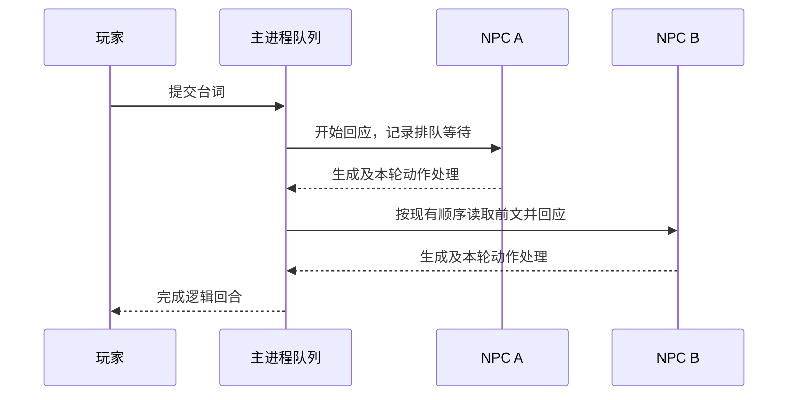

# V9.8 RC、多人对话与长期稳定性

## 冻结基线

2026-11-23，远端 `main` 为 `9362ff3ac7bae00662f4b06ed4ca04c5e831fc85`。与已验证功能提交 `e2fd6d790c8b6c304d0f9336fff2c03c6be0b106` 的差异只有 `docs/versions/v9/STATUS.md`。隔离检出已快进，实际安装仍为 9.7.4。[用户验收提交](https://github.com/wsdsb-111/VOCT-NEW/commit/9362ff3ac7bae00662f4b06ed4ca04c5e831fc85)

- 功能提交的 Windows CI 通过 545 组发布回归和打包冷启动、重启、退出、媒体解码。当前清单核实为 674 个测试文件、545 组发布检查和 128 项历史归档。基线部署回执记录 359 项，payload SHA256 为 `b9aebd5d460531fff3275e07aa2a8f162ba6a2e8dc7a138b30298e85b7896c08`。[功能提交的 CI](https://github.com/wsdsb-111/VOCT-NEW/actions/runs/44301455293)
- V9.7.4 的 CK3 双场姓名披露为 `PASS_USER_CONFIRMED`。V9.8 的现场兼容矩阵、真实 Provider、Primary Soak 和 Recovery Campaign 基线均为 `NOT_RUN`。
- 工程开发使用稀疏隔离检出。现场预检仍需记录实际存档副本、用户资料哈希和备份。自动化故障只写入合成测试环境，真实用户数据与正式安装不参与事务。
- 继续使用 Workshop 2.0.5、Bridge 1、Log 3.0、Summary 2.5、Official Action 2.0.3。Runtime 与 Workshop 各自分发。

## GLM 缓存处置

`GLM_CACHE_PROVIDER_LIMITATION_ACCEPTED`。原生命中率属于已知外部限制，可能频繁报告零命中。继续保留当前服务商布局、GLM 安全追加、原生 Usage、未知值和发送前来源复核。历史合成暖样本只支持其原实验条件。发布验收使用请求、预算、隐私、完成状态和使用量事实，无命中率门槛。

## 多人对话性能

在同一台 Windows 上，用 `node --max-old-space-size=384 scripts/measure-v9.8-multi-npc.js` 分别测量 9.7.4 基线和 V9.8 追踪代码。真实 `Conversation.sendMessage`、顺序队列和 V813 PromptBuilder 使用同一玩家问题、NPC 数量和可见正文长度，替身每请求等待约 8 ms，返回 STOP。每个后续请求均断言包含上一位 NPC 在本轮的发言。共 33 个玩家回合、72 次 NPC 请求、0 次失败。样本的长期输入为 70 对已预置的合成历史。模型、CK3 日志、真实记忆、Worldline 与 Action 效果延迟需现场采样。

| 参与 NPC / 玩家回合 | 首轮总耗时 ms 基线 → 候选 | 候选暖轮总耗时 ms p50／p95／最大 | 本地每轮 p50 ms 基线 → 候选 | 候选替身每请求 p50／p95／最大 ms | 替身累计等待占比 |
|---|---:|---:|---:|---:|---:|
| 1 / 10 | 40.74 → 40.22 | 15.95 / 20.17 / 20.17 | 4.32 → 3.52 | 11.50 / 14.07 / 14.07 | 63% |
| 2 / 10 | 31.02 → 23.41 | 26.20 / 41.00 / 41.00 | 6.81 → 6.05 | 9.88 / 20.78 / 21.13 | 78% |
| 3 / 5 | 37.99 → 36.21 | 45.87 / 49.80 / 49.80 | 8.24 → 8.83 | 10.80 / 20.79 / 20.79 | 80% |
| 4 / 3 | 48.74 → 52.82 | 66.84 / 69.09 / 69.09 | 10.14 → 10.43 | 11.94 / 21.68 / 21.68 | 83% |
| 3 / 5，长历史 | 36.30 → 46.47 | 40.36 / 45.82 / 45.82 | 11.41 → 9.99 | 10.34 / 15.76 / 15.76 | 75% |

暖轮样本较少，p95 是探索值。总时间包含串行请求与调度，首次启动受本地暖机影响。已存在的披露批处理在 1,000 条合成记录、10 次构造下从 60 次读取降至 10 次，结果与独立读取一致；候选继续采用这个已交付实现。离线测量未显示应改动业务行为的可重复本地瓶颈，优化结论为 `NO_CHANGE`。维护 NPC 顺序、Action、预算、Source Guard、Forget 和 Prompt 内容。

可选 `VOTC_DIAGNOSTICS=1` 记录主进程 IPC 时长、逻辑轮编号、尝试编号、NPC 队列位置、基础计划序列化、发送前来源复核及 30 秒主进程 RSS／Heap／CPU／活跃资源数。每位 NPC 的排队等待从本轮开始累计，包含前面 NPC 已用的时长。Renderer 输入到帧、CK3 解析、记忆、Worldline、Provider 首包／首正文、Action 分段继续沿用现有追踪。主进程 IPC 时长与逻辑轮派发时长分别记录，浏览器点击到 IPC 的跨进程关联、真正的 Provider 时延、系统句柄和单独的 ACK／Readback 时长仍需现场采样。活跃资源数是 Node 事件循环观测值。序列化时长包含在 Prompt 构建内，汇总时避免相加。

红测复现了旧追踪把 Provider 的截断、部分流和未知结果折成 `OK`。候选保留这些已归一化的终态，生成完成、计费及重试逻辑继续由原适配器处理。追踪导出仅含阶段状态、匿名场次键、序号、计数、资源数据与时长。

### 候选的真实 Provider 流式验证

使用用户授权额度中的 2 次请求，运行一轮合成双 NPC 对话。实际采用原配置 GLM-5.3-Flash、high、8192 输出预算。两次请求均为 `STOP / COMPLETE`，各一次尝试，最终出站证实第二个请求包含本轮第一个 NPC 的实际回复。配置和密钥文件的只读校验前后一致。

| 响应顺序 | 开始回应前累计排队 ms | Prompt 构建（内含序列化）ms | Provider 首包／首正文／终态 ms | 原生输入／输出／推理 Token |
|---|---:|---:|---:|---:|
| 1 | 0.87 | 17.52（0.96） | 2156.31 / 3182.27 / 3915.52 | 1867 / 53 / 34 |
| 2 | 3941.48 | 4.93（0.58） | 1050.16 / 3971.81 / 4220.66 | 1911 / 114 / 93 |

逻辑轮总时长 8169.78 ms，Provider 阶段合计约占 99.6%。样本仅一轮，不能外推到所有场次。两个请求原生均报告 0 缓存命中，Usage 发回核心计数，缺项保留为未知。该轮通过真实 Provider 和候选 Prompt 链路，CK3、真实存档、Action 与 Soak 继续独立验收。候选 payload SHA256 为 `9e818bbbbd1693156d0caf80fb34a505ebc9dce1b3e189c10d23fee4c8856ed1`。

## 工程 RC 与现场验收

Core／App／UI 与独立预览标识为 9.8.0。工程候选沿用既有源码清单和 Windows 发布流水线，保留 9.6.1 历史升级覆盖。新增 CI 从已固定源码与 payload SHA 的 9.7.4 冷启动，将同一个隔离合成档升级至 9.8.0、重复部署、回滚并再次启动，在最后恢复候选资源。当前工具链的事务对象为受管 Runtime 文件。公共更新器、安装器产包与分发依赖独立的已授权发布工作。

诊断提交 `64cabf3` 的隔离升级与回滚通过。随后同一 payload 的验收文档提交 `3fb41c9` 完整回归和独立打包冒烟通过，升级场次在 CDP 异步探针遇到 `Promise was collected`，应用退出码为 0。冒烟探针现持有 IPC 与媒体解码的 Promise 句柄直至完成，再释放句柄，并添加失败复现。Windows 探针与回滚证据继续按各自准确 SHA 留档。[早期成功](https://github.com/wsdsb-111/VOCT-NEW/actions/runs/45095670971) · [探针失败记录](https://github.com/wsdsb-111/VOCT-NEW/actions/runs/45095788851)

| 门禁 | 工程证据或现场条件 |
|---|---|
| 姓名、近亲与特殊关系 | 既有专项加同日期、同 ID、同长度改写；真实双场仅有 9.7.4 用户确认 |
| Memory、Worldline、Action、Letter | 运行原发布清单；真实存档的持久化、回读、权限和实机效果逐项确认 |
| Provider | 实际适配器合成出站、预算和权限复核；现场用明确授权的 Provider 与配额 |
| CK3／Workshop／兼容 Mod | 分别记录原版和每个适用兼容组合的版本、Bridge 与存档副本 |
| Primary Soak | 同一 CK3 和 Runtime 连续至少 120 分钟、至少 100 个有效玩家逻辑回合；至少有一位 NPC 完成才计该玩家回合 |
| Recovery Campaign | 独立验证 CK3／Runtime 重启、存档 LOAD、取消／断线、等待恢复和延迟 ACK |
| FULL_FREEZE | 工程、现场及回滚证据锁定到准确 SHA；P0／P1 清零，现场签署和最终公开发布另行确认 |

现场登记开始／结束时间（本地和 UTC）、准确版本、存档及数据 SHA、角色与隐私覆盖、逻辑轮和 NPC 完成／失败／取消数、真实 Usage、时延、资源曲线及 Action／Letter 状态。性能追踪为滚动窗口，现场需定期分段导出并核对 `droppedCount`。Primary 与恢复演练分开编号，保留失败窗口与原因。已知历史退出异常继续由每轮隔离冷启动和重启跟踪。
